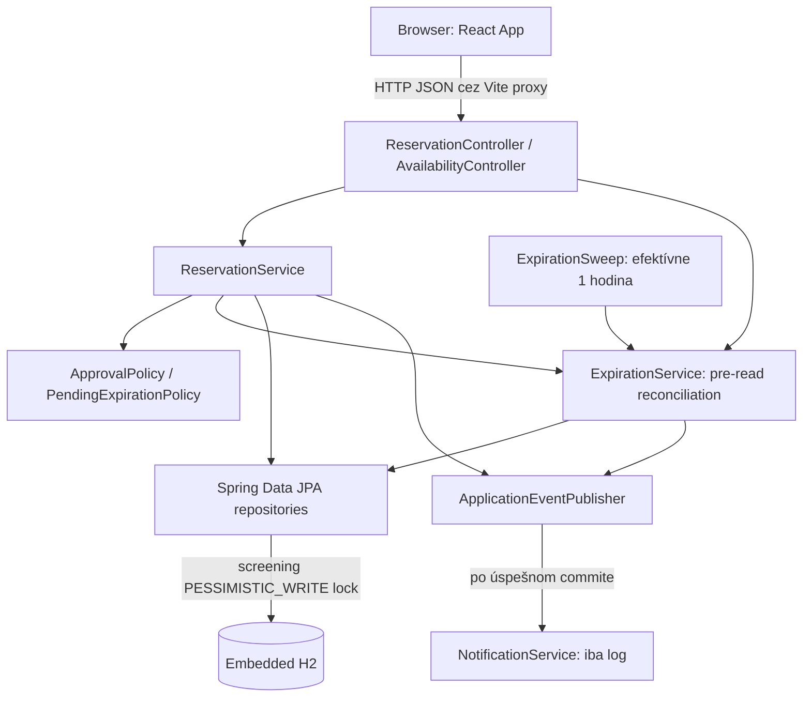

# Cinema Reservation System — priebežná projektová revízia SWI

**Dátum revízie:** 19. 10. 2026  
**Tím:** Deadlock  
**Analyzovaná vetva:** `main`  
**Commit:** `81a2628ad2bc9b722817d92c1bd9653d0f92e00a` — merge C05 detailed design  
**Rozsah:** aktuálny checkout, zdrojové kódy, konfigurácie, všetka projektová Markdown dokumentácia, build a verifikačné skripty, dostupná Git história a lokálne historické výsledky overovania.

Pred revíziou bol pracovný strom podľa `git status --short` čistý. Pri revízii nebol upravený zdrojový kód, konfigurácia, existujúca dokumentácia ani Git história. Tento report je jediným novým súborom v repozitári; nebol vykonaný commit ani push. Hodnotenie implementácie vychádza predovšetkým z kódu, nie z názvov commitov alebo tvrdení dokumentácie. Žiadne prihlasovacie údaje ani tajomstvá nie sú v reporte reprodukované.

## 1. Prehľad projektu

### 1.1 Účel a používatelia

Systém rieši rezervovanie jedného alebo viacerých sedadiel na konkrétne filmové predstavenie. Má zákazníkovi ukázať dostupnosť a zabrániť tomu, aby rovnaké sedadlo na rovnakej projekcii získali dve aktívne rezervácie. Rozlišuje rozpracovaný zámer zákazníka od skutočne pridelených miest. Vybrané miesta navyše vyžadujú samostatné schválenie, ktoré môže prísť neskôr, byť zamietnuté alebo vypršať.

V aktuálnom deme vystupujú zákazník/vlastník rezervácie a samostatný `Approver`. Zákazník vytvára, potvrdzuje, číta a ruší svoju rezerváciu; Approver rozhoduje o čakajúcej rezervácii. Dokument [intent-and-change.md](docs/intent-and-change.md) uvádza aj `Cinema Administrator` a `Cinema Operator`, ale administrátorské rozhranie ani správa kín implementované nie sú. „Registered User“ je dnes predpoklad existujúceho databázového ID, nie používateľský účet s registráciou a prihlásením.

### 1.2 Základné pojmy

| Pojem | Význam a aktuálne zobrazenie v kóde |
|---|---|
| `User` | Vlastník rezervácie; entita obsahuje iba generované `id`. |
| `Screening` | Konkrétna projekcia: text filmu `movie`, text sály `hall`, začiatok `startsAt`. |
| `Seat` | Fyzické miesto: `hall`, `rowNumber`, `seatNumber`. |
| `Reservation` | Jeden vlastník, jedna projekcia, množina miest, stav a časové/rozhodovacie údaje. |
| `Resource` | Špecifikačný pojem pre dvojicu `(Screening, Seat)`; samostatná Java entita neexistuje. |
| `Approver` | Demo autorita identifikovaná číslom; nie samostatná entita ani plnohodnotný systém rolí. |

Ten istý fyzický `Seat` môže byť rezervovaný pre odlišné projekcie. Viaceré návrhy môžu obsahovať rovnaké miesto; exkluzivita vzniká až pri `Confirm`. Sála a film dnes nie sú samostatné entity, ale reťazce.

### 1.3 Pravidlá, ktoré treba vedieť vysvetliť

1. `Create` vytvorí `DRAFT` a neblokuje sedadlá. Nekontroluje aktuálnu obsadenosť.
2. Vytvorenie je dovolené pri `now <= startsAt - 15 min`; presná 15-minútová hranica je povolená.
3. `Confirm` je dovolený len vlastníkovi, iba z `DRAFT` a striktne pred začiatkom projekcie.
4. Rovnaký Resource nesmie patriť inej `CONFIRMED` ani živej `PENDING_APPROVAL` rezervácii.
5. Ak ktorékoľvek sedadlo vyžaduje schválenie, čaká celá rezervácia a drží všetky sedadlá. Čiastočné schválenie neexistuje.
6. Demo politika vyžaduje schválenie pri **číslach sedadiel 3 a 4**, nezávisle od ich databázového ID. Oprávnený demo Approver má ID `3`.
7. Deadline je `min(approvalRequestedAt + timeout, startsAt)`; predvolený demo timeout je 60 sekúnd. Pri rovnosti s deadline už nastáva expirácia.
8. Vlastník môže pred začiatkom zrušiť `DRAFT`, živý `PENDING_APPROVAL` alebo `CONFIRMED`. Zrušenie záznam nemaže.
9. `CANCELLED`, `REJECTED` a `EXPIRED` sú konečné stavy. Nový pokus znamená novú rezerváciu.

Pravidlá majú konkrétnu realizáciu v `ReservationService`, `ApprovalPolicy`, `FinitePendingExpirationPolicy`, `ExpirationService` a repository dotazoch. Úplná aktuálna špecifikácia je [baseline v0.2](docs/c02_baseline_specification_v0.2.md).

## 2. Repozitár a technická štruktúra

### 2.1 Hlavné adresáre

| Cesta | Zodpovednosť a zistenia |
|---|---|
| [README.md](README.md) | Build/run pokyny, tím, pôvodný C01 rámec a walking skeleton; pôvodný trojstavový opis je už historický. |
| [backend/](backend/) | Java/Spring Boot aplikácia, Maven Wrapper, testy, fixtures, manuálny a API verifikačný scenár. |
| `backend/src/main/java/com/reservedbytes/cinema_reservation/` | Dva REST controllery, DTO, doménové entity, služby, Spring Data repositories a chyby. |
| `backend/src/main/resources/` | Základný profil, `dev` profil a SQL fixtures. |
| `backend/src/test/` | Unit testy, integračné HTTP/DB testy a testovacia H2 konfigurácia. |
| [frontend/](frontend/) | React/TypeScript SPA, Vite, CSS, API adaptér a CDP browser skript. |
| [docs/](docs/) | Baseline v0.1/v0.2, analýza zmeny, architektúra, ADR-01, C03 a C05 návrh a historická evidencia. |
| `.idea/` | IntelliJ projektové metadáta; napr. IDE používa JDK 23, ale POM cieli na Java 21. |
| `backend/target/` | Existujúce ignorované build výstupy, starší JAR, reporty, logy a screenshoty; nie sú autoritatívnym obrazom aktuálneho zdroja. |
| `frontend/node_modules/`, prípadné build výstupy | Lokálne závislosti a odvodené súbory, nie autorský zdroj projektu. |

Prešli sa sledované súbory aj relevantné lokálne artefakty. Nevykonával sa audit zdrojov každého tranzitívneho balíka v `node_modules`, obsahov Git objektov ani binárnych závislostí. V checkout-e sa nenašli projektové `AGENTS.md`, samostatné zadania PDF/DOCX/PPTX, Docker/Compose konfigurácia ani CI workflow. `frontend/dev.pid` je sledovaný súbor s prevádzkovým údajom; jeho prítomnosť nedokazuje bežiaci proces a hodí sa skôr medzi ignorované lokálne artefakty.

### 2.2 Jazyky, frameworky a vstupné body

Backend používa Java s cieľom **21**, Spring Boot **4.1.1**, Spring MVC, Spring Data JPA/Hibernate a embedded **H2**. Verzie deklaruje [pom.xml](backend/pom.xml). Spring Data JDBC starter je tiež závislosťou, ale JDBC repositories sú konfiguráciou vypnuté; produkčná repository vrstva používa `JpaRepository`. `JdbcTemplate` sa používa v testovacích fixtures, nie ako hlavná aplikačná persistence vrstva. Lombok generuje getters. OpenAPI/Swagger UI poskytuje `springdoc-openapi-starter-webmvc-ui` **3.1.0**.

Vstupom je [CinemaReservationApplication.java](backend/src/main/java/com/reservedbytes/cinema_reservation/CinemaReservationApplication.java), metóda `main()`. Zapína scheduling a poskytuje bean `Clock.systemUTC()`. Maven Wrapper má wrapper verziu `3.3.4` a distribúciu Maven `3.9.16` podľa `backend/.mvn/wrapper/maven-wrapper.properties`.

Frontend používa React a React DOM **19.2.8** v deklarovanom rozsahu, TypeScript **~6.0.2**, Vite **^8.3.0**, React Vite plugin **^6.1.1** a Oxlint **^1.81.0**. Zdrojom deklarácií je [package.json](frontend/package.json); lockfile zachytáva konkrétny dependency strom. Vstup `frontend/index.html` načíta [main.tsx](frontend/src/main.tsx), ktorý renderuje `App` v `StrictMode`. Hlavná obrazovka je [App.tsx](frontend/src/App.tsx), HTTP adaptér [reservations.ts](frontend/src/reservations.ts).

`tsconfig*.json` oddeľujú browser aplikáciu a Node/Vite konfiguráciu, používajú `noEmit` a prísne kontroly nepoužitých deklarácií. `.oxlintrc.json` zapína React/TypeScript/Oxc kontroly vrátane hooks. `App.css` a `index.css` definujú responzívnu mapu miest, stavové farby a layout. V `assets/` zostali aj šablónové obrázky React/Vite a `hero.png`; aktuálny `App` ich neimportuje. SVG/public obrázky nie sú architektonické diagramy.

### 2.3 Konfigurácia a persistence

| Konfigurácia | Skutočné správanie |
|---|---|
| [application.yaml](backend/src/main/resources/application.yaml) | File-backed H2 v relatívnej ceste `./data/cinema-reservation`, Hibernate `ddl-auto: update`, `open-in-view: false`, JDBC repositories vypnuté. |
| [application-dev.yaml](backend/src/main/resources/application-dev.yaml) | Pamäťová H2 `cinema-dev`, `create-drop`, SQL inicializácia z `dev-data.sql`; záznamy sa pri reštarte stratia. |
| [test application.yaml](backend/src/test/resources/application.yaml) | Pamäťová H2 `cinema-test`, `create-drop`; testy pracujú s izolovanými dátami. |
| `demo.approval-timeout` | Injektované v `FinitePendingExpirationPolicy`, default `PT60S`; musí byť kladné. |
| `demo.expiration-sweep-ms` | Základný aplikačný YAML nastavuje `3600000`, teda hodinu. `@Scheduled` má fallback `1000`, ktorý sa pri načítanom YAML nepoužije. |
| [vite.config.ts](frontend/vite.config.ts) | Vite bind `127.0.0.1:5173`, `strictPort: true`, proxy `/reservations` aj `/screenings` na `http://localhost:8080`. |

Pretože cesty H2 sú relatívne k working directory, spustenie z iného adresára môže vytvoriť inú lokálnu databázu. Default profil neobsahuje fixtures a neposkytuje API na vytvorenie používateľov/projekcií/miest; prázdna DB preto nestačí na UI demo. `dev` profil tento problém rieši inicializáciou známych dát.

Nie je zavedený Flyway/Liquibase ani verzovaný migračný postup. `ddl-auto: update` nie je dôkazom bezpečnej migrácie budúcej active-allocation tabuľky. File-backed konfigurácia dokazuje úmysel ukladať dáta na disk; úspešná obnova pending workflow po reštarte aktuálnej aplikácie nebola pri revízii overená.

### 2.4 Dokumenty a diagramy

| Dokument | Úloha a hodnota pri revízii |
|---|---|
| [intent-and-change.md](docs/intent-and-change.md) | Pôvodný účel, stakeholderi a pravidlá; časť o TTL draftu je otvorená otázka. |
| [c02_baseline_specification.md](docs/c02_baseline_specification.md) | Zachovaný v0.1 model: štyri operácie, tri stavy, pravidlá a verifikácia. |
| [c02-change-impact-analysis.md](docs/c02-change-impact-analysis.md) | Analýza dopadu zavedenia oneskoreného schvaľovania. |
| [c02_baseline_specification_v0.2.md](docs/c02_baseline_specification_v0.2.md) | Aktuálny kontrakt REQ-01–12, BR-01–09, OP-01–05 a V-01–17. |
| [c02-task14-report.md](docs/c02-task14-report.md) | Historický implementačný a runtime/browser report z 4. 10.; nie nový výsledok tejto revízie. |
| [c03_part_a.md](docs/c03_part_a.md) | AS-IS mapovanie so závažnými vecnými nepresnosťami; nemožno ho bez opráv prezentovať ako opis kódu. |
| [c03.md](docs/c03.md) | Architektonické drivery, porovnanie alternatív, ADR-01, Mermaid G1–G4, H/I a backlog J–L. Rozlišuje TO-BE a AS-IS. |
| [architecture-and-decisions.md](docs/architecture-and-decisions.md) | Aktuálne C02 rozhodnutia a C05 detailný návrh pending expiration: D1–D6, kontrakty, class/sequence diagram a algoritmus. |
| [evidence-and-evolution.md](docs/evidence-and-evolution.md) | História overovania, C05 mapovanie návrh–kód–test, tvrdenie o 74 úspešných testoch a obmedzenia prostredia. |
| [MANUAL-TESTING.md](backend/MANUAL-TESTING.md), [frontend README](frontend/README.md) | Reprodukcia demo scenárov, fixtures, HTTP konvencie a browser skript. |

Doménový obrázok C1 v C03 je externý GitHub attachment, nie lokálny súbor. Jeho grafický obsah nebol pri tejto lokálnej revízii overený. Textové Mermaid diagramy boli čítané; samotný grafický rendering sa nespúšťal. Originálne učiteľské zadanie C05, ktoré evidencia označuje ako `SWI_C05_Detailed_Design_students_toggle_v4 (1).html`, v repozitári chýba. Jediné sledované HTML je vstupná stránka frontendu. Úplnosť odovzdania voči originálnym cvičeniam preto nemožno nezávisle potvrdiť.

## 3. Čo je skutočne implementované

### 3.1 Význam statusov v tejto revízii

| Status | Význam |
|---|---|
| **IMPLEMENTED** | Konkrétna realizácia je v aktuálnom zdroji. Neznamená automaticky nový úspešný runtime test. |
| **PARTIALLY IMPLEMENTED** | Základ existuje, ale chýba časť rozsahu alebo ide o demo náhradu produkčnej funkcie. |
| **DOCUMENTED ONLY** | Existuje požiadavka/návrh, ale jeho realizácia v kóde sa nenašla. |
| **NOT IMPLEMENTED** | V kontrolovanom checkout-e sa implementácia nenašla. Neimplikuje to automaticky povinnosť v školskom scope. |
| **CANNOT VERIFY** | Dostupné dôkazy nestačia, napríklad chýba originálne zadanie alebo nový runtime/restart test. |

### 3.2 Entity a databázový model

Entity sú v [model/](backend/src/main/java/com/reservedbytes/cinema_reservation/model/). Všetky používajú generované `Long` ID so stratégiou `IDENTITY`.

| Trieda | Dáta a vzťahy |
|---|---|
| `User` | Tabuľka `cinema_users`, iba `id`. Bez mena, e-mailu, hesla a rolí. |
| `Screening` | `movie`, `hall`, `Instant startsAt`; žiadna entita Movie/Hall. |
| `Seat` | `hall`, `rowNumber`, `seatNumber`; unique constraint na `(hall, row_number, seat_number)`. |
| `Reservation` | `ManyToOne` na User aj Screening, obe povinné a lazy; `ManyToMany Set<Seat>` cez `reservation_seats`. |

Unique constraint join tabuľky je iba `(reservation_id, seat_id)`: zabráni opakovaniu miesta v jednej rezervácii, **nevynucuje jedinečnú aktívnu rezerváciu pre `(screening_id, seat_id)`**. Aktívna alokácia sa odvodzuje zo stavu celej rezervácie. História členstva sedadiel zostáva zachovaná aj po uvoľnení.

`Reservation` uchováva `status`, `createdAt`, `cancelledAt`, `approvalRequestedAt`, `approvalDeadline`, `authorizedApproverId`, `approvalRequiredSeatIds` cez `@ElementCollection`, `approvalPolicy`, `decision`, `decidedBy`, `decidedAt` a `expiredAt`. Číselné ID rozhodujúcej osoby nie je JPA vzťah na User. Nie je to všeobecný audit log: neexistuje samostatný nemenný záznam každej vykonanej operácie ani samostatný `confirmedAt`.

### 3.3 Vrstvy, zodpovednosti a algoritmy

- `ReservationController`: HTTP mapovanie vytvorenia, potvrdenia, zrušenia, čítania a rozhodnutia; nevolá repository priamo.
- `AvailabilityController`: pred čítaním zavolá `ExpirationService.expireScreening()`, potom `ReservationService.availability()`.
- `ReservationService`: ručná validácia Create, vlastníctvo, stavové/časové guardy, kontrola konfliktov, policy branch a publikácia výsledkov.
- `ApprovalPolicy.requiresApproval(Seat)`: `seatNumber == 3 || seatNumber == 4`; konštanta `DEMO_APPROVER_ID = 3L`.
- `PendingExpirationPolicy` a `FinitePendingExpirationPolicy`: čistý kontrakt výpočtu deadline a `isDue`; bez databázy, scheduleru a vlastného systémového času.
- `ExpirationService`: transakcia, zámok projekcie, načítanie pending záznamov a prechod cez `expireIfDueLocked()`.
- `ExpirationSweep.sweep()`: nájde projekcie s pending rezerváciami a vyvolá expiráciu po jednej projekcii. Neskenuje iba už splatné deadline; rozhodnutie zostáva službe.
- `NotificationService.notifyReservationChanged()`: `@TransactionalEventListener`, po commite zapíše správu do logu.
- Repositories: štyri `JpaRepository`; `ScreeningRepository.findLockedById()` používa `PESSIMISTIC_WRITE`, `ReservationRepository` obsahuje JPQL pre aktívne miesta, konflikty a scalar lookup projekcie.

`lockedReservation(id)` najprv zistí iba screening ID, získa zámok projekcie a až potom načíta Reservation. Tým sa znižuje riziko použitia starej entity po čakaní na lock. Všetky lifecycle zmeny jednej projekcie sa serializujú vrátane rezervácií na navzájom rôzne sedadlá. Aj owner read a availability používajú zámok, hoci ich služby deklarujú read-only transakciu.

Zmeny stavov sa ukladajú JPA dirty checkingom managed entity pri commite. `confirm()`, `cancel()` a `approval()` preto nepotrebujú explicitné `save()` po každom prechode. Samotné entity metódy nemajú úplné guardy; predpokladajú správne použitie zo služieb. Interné public `expireDueLocked()` a `expireIfDueLocked()` majú transakčnú/lock precondition opísanú v komentári, nie dynamicky vynútenú vlastnou kontrolou.

### 3.4 REST API podľa controllerov

| Metóda a cesta | Vstup | Úspech | Dôležitý detail |
|---|---|---|---|
| `POST /reservations` | JSON `userId`, `screeningId`, `seatIds` | `201`, iba `{"id":...}` | Bez `X-User-Id`; používateľ sa preberá z body. Response neobsahuje celý stav ani explicitný `Location` header. |
| `GET /screenings/{screeningId}/availability` | Path ID | `200`, pole `SeatAvailability` | Verejná demo query bez identity; pre-read môže expirovať záznamy. |
| `GET /reservations/{id}` | `X-User-Id` | `200`, `ReservationResponse` | Kontrola vlastníka, pred ňou samostatné expiration reconciliation. |
| `POST /reservations/{id}/confirm` | `X-User-Id` | `200`, `CONFIRMED` alebo `PENDING_APPROVAL` | Iba vlastník a DRAFT. |
| `POST /reservations/{id}/cancel` | `X-User-Id` | `200`, `CANCELLED` | Iba vlastník, pred začiatkom, pending musí byť živý. |
| `POST /reservations/{id}/approval` | `X-User-Id`, JSON `decision` | `200`, `CONFIRMED` alebo `REJECTED` | Iba autorizovaný demo Approver, iba živý pending; presné hodnoty `APPROVE`/`REJECT`. |

Nenašlo sa API na zoznam filmov/projekcií, vytváranie účtov, správu sál/miest, zoznam vlastných rezervácií, platbu alebo verejné ručné `expire`. Exspirácia je interná systémová operácia. Swagger/OpenAPI sú infraštruktúrne rozhrania závislosti, nie ďalšia doménová funkcionalita.

### 3.5 Chyby a autorizácia

[ApiExceptionHandler](backend/src/main/java/com/reservedbytes/cinema_reservation/exception/ApiExceptionHandler.java) mapuje `ReservationException` na príslušný HTTP status a Spring `ProblemDetail`. Nečitateľné JSON mapuje na `400` s detailom `Malformed request body.`

| Kód | Typické prípady podľa kódu |
|---|---|
| `400` | Neplatné ID vo vytvorení, prázdne/duplicitné miesta, miesto z inej sály, nesprávne JSON, nepovolené rozhodnutie. |
| `403` | Volajúci nie je vlastník; nesprávny demo Approver. |
| `404` | Chýbajúci používateľ, projekcia, miesto alebo rezervácia. |
| `409` | Neskoré vytvorenie, začatá projekcia, konflikt alokácie, neplatný zdrojový stav, opakovaný/stará rozhodnutie, dosiahnutá deadline. |

Chýbajúce alebo nesprávne typované headery/path parametre rieši Spring MVC; vlastný handler pre tieto prípady nie je. Mapovanie lock timeoutov, `DataIntegrityViolationException` a iných infraštruktúrnych chýb na stabilný doménový kontrakt implementované nie je. Netreba tvrdiť, že každý databázový problém skončí ako `409`.

`X-User-Id` je ľubovoľne nastaviteľný header. Kontrola vlastníctva a demo autority existuje, ale nie je bezpečnostne dôveryhodnou autentifikáciou. Create navyše akceptuje používateľa z body. `approval()` porovnáva číslo s uloženým approver snapshotom, prípadne demo defaultom, bez overenia prihlasovacej identity či všeobecných resource-scoped grants.

`confirm/cancel/approval` používajú `@Transactional(noRollbackFor = ReservationException.class)`. Doménová chyba tak môže v tej istej transakcii ponechať uloženú nezávislú systémovú expiráciu inej alebo dotknutej rezervácie; požadovaný neplatný prechod sa nevykoná. Toto je zámerné a dôležité pri vysvetľovaní odpovede `409` spolu so zmenou na `EXPIRED`.

### 3.6 Matica hlavných funkcií

| Funkcia | Status | Dôkaz a hranica tvrdenia |
|---|---|---|
| Vytvorenie neblokujúceho draftu | IMPLEMENTED | `ReservationService.create()`, constructor `Reservation`, Create integračné testy. |
| Validácia vstupov a 15-minútovej hranice | IMPLEMENTED | Ručné guardy v `create()`, `acceptsExactlyFifteenMinutesBeforeStart`. |
| Dostupnosť pre konkrétnu projekciu | IMPLEMENTED | `availability()`, `findActiveSeatIds()`, `SeatAvailability`. |
| Priame potvrdenie a vlastníkovo storno | IMPLEMENTED | `confirm()`, `cancel()`, testy stavov a časovej hranice. |
| Čakajúca rezervácia, rozhodnutie, uvoľnenie | IMPLEMENTED | `requestApproval()`, `approval()`, `decide()`, terminal release testy. |
| Produkčné approval pravidlá a prideľovanie autorít | PARTIALLY IMPLEMENTED | Funkčná je len `ApprovalPolicy` s číslami 3/4 a Approver 3; administrácia chýba. |
| Expirácia a stabilná deadline | IMPLEMENTED | `FinitePendingExpirationPolicy`, `ExpirationService`, command/read rechecks. |
| Presné priebežné spracovanie expirácie bez požiadaviek | PARTIALLY IMPLEMENTED | Scheduler existuje, ale efektívny interval je hodina, bez testu real-time scheduler SLA. |
| Ochrana súbehu cez screening lock | IMPLEMENTED | `PESSIMISTIC_WRITE`, spoločná lock cesta, opakované race testy. |
| C03 databázová unique aktívna alokácia | DOCUMENTED ONLY | ADR-01/G2/J-01; chýba samostatná relation aj constraint `(screening_id, seat_id)`. |
| Uloženie histórie výsledku | IMPLEMENTED | Response aj entita uchovávajú deadline, rozhodnutie, aktéra a outcome časy. Nie kompletný audit trail. |
| Notifikácia po commite do logu | IMPLEMENTED | `NotificationService` a spy/rollback testy. |
| Skutočné externé notifikácie | PARTIALLY IMPLEMENTED | Len logovací boundary; žiadny provider, e-mail/SMS klient, adresát ani doručenie. |
| Transactional outbox a persistent retry | DOCUMENTED ONLY | C03 G2/J-05, bez entity/repository/dispatcher implementácie. |
| React rezervovanie a demo Approver | IMPLEMENTED | `App.tsx`, `reservations.ts`, reálne fetch volania. Nový browser priechod nebol vykonaný. |
| Registrácia, login a dôveryhodné role | NOT IMPLEMENTED | `User` má iba ID, chýba security konfigurácia aj identity provider. |
| Katalóg, administrácia a multi-screening UI | DOCUMENTED ONLY | Širšie roly v project frame; UI má fixné user/screening ID a fixture texty. |
| Platba, ticketing, QR vstupenky | NOT IMPLEMENTED | Nenájdené v zdroji; v aktuálnej baseline nie sú stanovené ako povinné. |
| DRAFT TTL | DOCUMENTED ONLY | Otvorená budúca otázka; v0.2 ho výslovne nezavádza. |
| Obnova po reštarte a multi-instance bezpečnosť | CANNOT VERIFY | Existuje file-backed H2 konfigurácia, ale chýbajú aktuálne restart/distributed dôkazy. |

## 4. Požiadavky verzus implementácia

### 4.1 Traceability aktuálnej baseline

V tabuľke je „IMPLEMENTED“ posúdenie zdroja voči lokálnej demo variante. Nenahrádza nové spustenie backend testov. Java cesty sú relatívne k `backend/src/main/java/com/reservedbytes/cinema_reservation/`; testy sú v rovnakom package pod `src/test/java`.

| Požiadavka | Očakávané správanie | Aktuálna implementácia | Status | Dôkaz |
|---|---|---|---|---|
| REQ-01 / OP-01 | Validný vstup vytvorí jeden neblokujúci DRAFT. | Kontrola ID, existencie, sály, miest a času; `save(new Reservation(...))`. | IMPLEMENTED | `ReservationService.create`, `createsAndCommitsDraftWithAllSelectedSeats`, `rejectsInvalidRequestsWithoutWriting`. |
| BR-03 | Create povolený aj presne 15 min pred začiatkom. | Odmieta iba `now.isAfter(startsAt.minus(15 min))`. | IMPLEMENTED | `acceptsExactlyFifteenMinutesBeforeStart`, `rejectsLessThanFifteenMinutesAndPastScreenings`. |
| REQ-02 / BR-01,05,08 | Availability zohľadňuje potvrdené a živé pending, nie draft/terminal/due. | `findActiveSeatIds` má `approvalDeadline > now`; čítaniu predchádza reconciliation. | IMPLEMENTED | `availability`, `dueExpirationIsResolvedForAvailabilityAndNewAcquisitionWithoutDecision`. |
| REQ-03 / OP-03 | Confirm získa všetky miesta priamo alebo ako jeden pending hold. | Policy branch nad celou množinou miest. | IMPLEMENTED | `confirm`, `mixedReservationHoldsAllSeatsAndApprovalPreservesHoldAndHistory`. |
| REQ-04 / BR-02 | Konfliktné paralelné Confirm majú najviac jednu aktívnu rezerváciu. | Screening lock a kontrola iných pending/confirmed. | IMPLEMENTED | `concurrentConflictingConfirmationsHaveOneWinner`, `concurrentPendingConfirmationsHaveOneWinner`. Rozsah: aplikačná cesta a H2 testy. |
| REQ-05 / OP-04 | Len vlastník zruší prípustný stav pred začiatkom. | `lockedReservation(id,userId)`, stavové a časové guardy. | IMPLEMENTED | `cancel`, `rejectsNonOwnersAndMissingReservationsWithoutChangingState`, `confirmAndCancelRespectStartBoundary`. |
| REQ-06 | Storno ponechá záznam a uvoľní miesta. | Status `CANCELLED`, `cancelledAt`; blocking je status-based. | IMPLEMENTED | `availabilityTracksOnlyConfirmedAndCancellationPreservesHistory`. |
| REQ-07 / BR-06 | Súbežné lifecycle operácie majú platné sekvenčné výsledky. | Spoločný zámok pre Confirm/Cancel/decision/expiration. | IMPLEMENTED | `concurrentConfirmCancelLeavesCancelledAndNeverResurrects`, `approvalCancelRaceNeverResurrects`, `approveRejectRaceHasOneDecisionAndOneNotification`. |
| REQ-08 / BR-07 | Rozhoduje iba oprávnená osoba pre potrebné Resources. | Porovnanie s uloženým demo Approver ID; chýba dôveryhodná identita a všeobecné grants. | PARTIALLY IMPLEMENTED | `approval`, `ApprovalPolicy`, `unauthorizedAndInvalidDecisionsDoNotChangePendingOrHold`. Demo správanie je realizované. |
| REQ-09 | APPROVE potvrdí živý pending bez release okna. | Zmena statusu tej istej rezervácie; členstvo miest ostáva. | IMPLEMENTED | `Reservation.decide`, mixed approval test. |
| REQ-10 | REJECT uvoľní celý hold a uchová výsledok. | `REJECTED`, decision/actor/time, event. | IMPLEMENTED | `terminalReleaseIsAtomicAndStaleDecisionsCannotAffectNewAllocation`. |
| REQ-11 / BR-08 | Deadline znamená EXPIRED a release aj bez Approver volania. | Clock policy, sweep, pre-read a command reconciliation; oneskorený worker nesmie schváliť neskoro. | IMPLEMENTED | `expireIfDueLocked`, `approvalDeadlineBoundaryAndReadOnlyAvailability`, C05 worker test. Fyzické zapísanie stavu pri úplnej nečinnosti môže meškať do sweepu. |
| REQ-12 / BR-09 | Vlastník vidí pending, deadline a výsledok. | Owner GET + `ReservationResponse`, UI pending polling. | IMPLEMENTED | `get`, `ReservationResponse.from`, `App.tsx`. |
| BR-09 notifikačný boundary | Iniciovať správu len pri skutočnom výsledku po commite. | Spring event + logovací listener; nie doručenie človeku. | PARTIALLY IMPLEMENTED | `notificationsAreInvokedForCommittedTransitionsOnly`, C05 rollback test. |
| ADR-01 / J-01–04 | DB autoritatívne odmietne duplicitný aktívny Resource. | Zatiaľ iba aplikačná kontrola pod databázovým zámkom. | DOCUMENTED ONLY | `c03.md` F/G/J vs `Reservation` join constraint. |
| C03 J-05 | Outbox, stabilné event ID, retry a obnova. | Iba neprenášané Spring events a log. | DOCUMENTED ONLY | `c03.md` G2/K/L, `NotificationService`. |
| C03 J-07–08 | Expirácia a query zosúladené s budúcou active-allocation transakciou. | Súčasná status-based verzia funguje v existujúcom návrhu; cieľová verzia neexistuje. | DOCUMENTED ONLY | C03 J/K; aktuálne `noRollbackFor` nie je dôkaz hotovej budúcej transakcie. |
| C03 H2 | Konkrétny design class diagram podporujúci H1. | V C03 je iba nadpis bez diagramu. | DOCUMENTED ONLY | `docs/c03.md`, časť H2. C05 má iný, úzko zameraný class diagram. |
| C03 J-12/L2 | Reprodukovateľný architecture check v repozitári. | Checker je uvedený ako blok textu, `backend/check_architecture.py` chýba. | PARTIALLY IMPLEMENTED | C03 L2 uvádza historický PASS; kontroléry teraz nemajú priame persistence imports. |
| C05 D1–D6 | Kladný timeout, bezpečný cap, presný guard, lock/load, efektívny čas a jeden transition event. | Rozhranie policy, finite implementácia a centralizovaná expiration metóda. | IMPLEMENTED | `PendingExpirationPolicyTests` 8 prípadov, `ExpirationServiceTests` 4, 2 nové integračné testy. |
| Širšia správa kín | Administrátor spravuje filmy, projekcie, sály a sedadlá. | Fixtures a repositories, bez management API/UI. | DOCUMENTED ONLY | `intent-and-change.md` vs controllery a frontend. |
| Úplnosť voči originálnym zadaniam | Splnenie všetkých povinných školských krokov a artefaktov. | Dostupné sú tímové interpretácie a DoD tabuľky, nie originály. | CANNOT VERIFY | Chýba uvedené C05 HTML aj samostatné originálne zadania C01–C03/C04. |

### 4.2 Konkrétne rozpory a zastarané tvrdenia

1. **AS-IS C03 Part A používa neexistujúce identifikátory.** `confirmReservation()`, `getState()`, `findConflicting()`, `findConflicts()`, `ConflictException` a `NotificationClient` nie sú aktuálne prvky systému. Správne sú controller `confirm()`, `getStatus()`, `countOtherAllocations()`, `ReservationException` a `NotificationService`.
2. **Tvrdenie, že existujúci kód nemá explicitný lock, je nesprávne.** `ScreeningRepository.findLockedById()` má `PESSIMISTIC_WRITE` a používa sa pred načítaním rezervácie. C03 I tieto opravy už zaznamenáva, ale Part A zostala neopravená.
3. **Notifikácie nie sú synchronné HTTP volanie.** Ide o after-commit Spring listener s logovaním. PostgreSQL spomenuté v Part A nie je nakonfigurované; používa sa H2.
4. **Jednosekundový sweep v návodoch nezodpovedá efektívnej konfigurácii.** `application.yaml` má `3600000`; `dev` ani test YAML tento údaj neprepisujú. Scheduler nie je formálne vypnutý, iba pri krátkych testoch zvyčajne nezasiahne. Dokumentácia tvrdí „disabled“ a „every second“, čo treba spresniť.
5. **C03 historický port 8081 nie je súčasný zdrojový default.** Aktuálny YAML neobsahuje `server.port`; štandardný Spring default a Vite proxy smerujú na 8080. Externý argument/env môže port zmeniť, ale aktuálne spustenie na 8081 nebolo potvrdené.
6. **README a project frame opisujú pôvodný trojstavový model.** Aktuálne existuje šesť stavov. v0.1 je zámerne zachovaná história; problému sa predíde označením aktuálneho zdroja pravdy v0.2.
7. **C03 H1 je nedokončený návrh.** Ukazuje vždy `CONFIRMED`, neurčitý „lock alebo constraint“, neukazuje explicitný rollback a používa plánované výnimky. Neopisuje kompletný aktuálny approval flow ani presnú vybranú TO-BE implementáciu; H1 nadpis je duplicitný, H2 prázdny.
8. **Historické HEAD/commit/tag tvrdenia nie sú aktuálny Git stav.** Evidencia nazýva `4d24381` HEAD a C05 spomína lokálny tag `c05-detailed-design-v1`; aktuálny HEAD je `81a2628` a `git tag -n` v tomto klone nevrátil žiadny tag. Existenciu tagu inde nemožno vylúčiť, lokálne však potvrdený nie je.
9. **„74 tests PASS“ je uložená C05 evidencia, nie aktuálny lokálny Surefire výsledok.** Lokálne XML sú z 4. 10. a pokrývajú 60 vykonaní. Nové C05 testy v nich nie sú.

## 5. Rezervačný workflow krok za krokom

### 5.1 Skutočný Create

1. Frontend načíta dostupnosť projekcie `1`; používateľ vyberie sedadlá. UI používa používateľa `1` a fixture text filmu/sály.
2. `POST /reservations` pošle napr. `{"userId":1,"screeningId":1,"seatIds":[1,3]}`.
3. Spring deserializuje `CreateReservationRequest`; chybné JSON skončí cez error handler.
4. `ReservationService.create()` overí kladné ID, neprázdny zoznam, žiadne null/duplicitné sedadlá.
5. Načíta User, Screening a všetky Seat. Chýbajúce entity znamenajú `404`; sála musí presne zodpovedať reťazcu sály projekcie.
6. Odčíta injected `Clock`; príliš neskorý Create vráti `409`.
7. **Nekontroluje dostupnosť**, nevyžaduje schválenie a nezískava alokačný screening lock. To zodpovedá neblokujúcemu draftu.
8. V transakcii uloží `Reservation` s `DRAFT`, vlastník/projekcia/miesta a `createdAt`.
9. Vráti `201` s jediným poľom `id`. Frontend následne cez owner GET načíta celú rezerváciu a obnoví availability.

Create sa teda môže podariť aj pre obsadené miesto. Zákazník ešte nemá garantované sedadlo a Create neposiela finálnu notifikáciu.

### 5.2 Confirm a alokácia

1. Zákazník odošle `POST /reservations/{id}/confirm` s owner headerom.
2. Služba scalar dotazom zistí projekciu, získa `PESSIMISTIC_WRITE` lock a potom načíta aktuálnu rezerváciu.
3. Overí vlastníctvo a spracuje splatné pending rezervácie tej istej projekcie.
4. Vyžaduje `DRAFT` a čas pred začiatkom.
5. `countOtherAllocations()` hľadá prekryv s inými `PENDING_APPROVAL`/`CONFIRMED`; splatné pending sa predtým vyriešili. Konflikt znamená `409` bez čiastočného získania voľných miest.
6. Ak nič nevyžaduje approval, `Reservation.confirm()` nastaví `CONFIRMED` a publikuje finálny event.
7. Inak `requestApproval()` uloží `PENDING_APPROVAL`, snapshot potrebných seat IDs, label politiky, Approver ID, request time a vypočítanú deadline. **Všetky** miesta blokuje spoločný status. Finálny confirmation event ešte nevznikne.
8. Commit uloží dirty entity a uvoľní lock; odpoveď je `200` s celým `ReservationResponse`.

### 5.3 Rozhodnutie, storno a expirácia

Pri `approval()` sa po lock/load najprv kontroluje demo autorita a validita rozhodnutia. Potom sa reconciliuje expirácia, vyžaduje živý pending a preverí vlastný hold voči iným alokáciám. APPROVE zmení stav na CONFIRMED, REJECT na REJECTED; uloží aktéra/čas/rozhodnutie a publikuje event. Po schválení nie je uvoľňovacie okno: rovnaká rezervácia zostáva blokujúca.

Cancel overí vlastníka, stav, prípadnú expiráciu a čas projekcie. Zmena na CANCELLED uvoľní všetky miesta status-based spôsobom a zachová outcome históriu. Neskoré approval/cancel neprepíšu terminal stav; odpoveď je `409`.

Expiráciu spúšťa sweep, status/availability pre-read alebo lifecycle command. `isDue()` platí pre pending a `observedAt >= deadline`. `Reservation.expire()` nastaví `EXPIRED` a `expiredAt = approvalDeadline`, teda efektívny čas, nie čas spracovania. Opakované spracovanie terminal záznamu už nepublikuje ďalší expiration event.

Availability SQL ignoruje splatný pending aj vtedy, ak deadline nastala medzi pre-read expiráciou a vlastným dotazom. Fyzická zmena statusu a log notifikácia však môžu pri úplnej nečinnosti meškať do hodinového sweepu. UI pending polling každú sekundu vytvára požiadavky, ktoré reconciliation pravidelne spustia.

### 5.4 AS-IS architektúra



Toto je súčasný stav. C03 TO-BE navyše navrhuje databázovú relation aktívnych alokácií s unique Resource kľúčom a durable outbox s dispatcherom. Tieto prvky do AS-IS diagramu nepatria.

## 6. Testy a výsledky overenia

### 6.1 Existujúce automatizované testy

| Suite | Typ a rozsah | Počet vykonaní odvodený z aktuálneho zdroja |
|---|---|---:|
| `CinemaReservationApplicationTests` | Spring context smoke test `contextLoads`. | 1 |
| `PendingExpirationPolicyTests` | Unit bez Springu: timeout vetva, cap vrátane rovnosti, overflow, chybná konfigurácia a vstupy, nanosekundová deadline, ostatné stavy. | 8 |
| `ExpirationServiceTests` | Unit s Mockito repository/publisher: jeden transition/event, live no-op, lock pred load a Clock, chýbajúca projekcia. | 4 |
| `ReservationIntegrationTests` | Spring Boot na náhodnom HTTP porte, JPA/H2, reálne HTTP požiadavky, kontrola commitu, `NotificationService` spy, parameterized/repeated prípady. | 61 |
| **Spolu** | Počet zahŕňa rozvinuté parametre a opakovania, nie počet metód. | **74** |

Integračné testy pokrývajú neplatné JSON/vstupy, neexistujúce referencie, nesprávnu sálu, presnú creation hranicu, neblokujúce drafty, obsadenosť, vlastníctvo, Confirm/Cancel pri začiatku projekcie, approval metadata, zmiešané holds, nesprávnu autoritu/decision, všetky release cesty a stale decision po novom pridelení. `TIME` je zdieľaný `AtomicReference<Instant>` a test bean `Clock` ho číta; testy nemusia čakať reálnych 60 sekúnd.

Race testy využívajú dva executory, bariéru a súbežné HTTP volania. Priame Confirm/Confirm a Confirm/Cancel sa opakujú päťkrát, pending varianty a decision races trikrát. Je to užitočný integračný dôkaz pre daný engine a scenáre, nie load test ani formálny dôkaz všetkých interleavings.

C05 pridáva osem policy unit testov, štyri service unit testy a dva integračné prípady: `c05RepeatedWorkerCommitsOneExpirationAndReleasesWholeHold()` a `c05RollbackRestoresPendingAndSuppressesExpirationNotification()`. Druhý explicitne overuje JPA rollback a potlačenie after-commit listenera; mock unit test toto sám nedokáže.

### 6.2 E2E a manuálne skripty

[backend/verify-baseline.ps1](backend/verify-baseline.ps1) testuje živé API, Swagger/OpenAPI a toky A–F, vytvára rezervácie a čaká na reálnu deadline. Nie je to izolovaný unit test. Vyžaduje vhodnú čerstvú demo databázu a jeho spustenie mení jej dáta.

[frontend/verify-ui.mjs](frontend/verify-ui.mjs) riadi Chromium/Edge cez Chrome DevTools Protocol a lokálny debugging port `9222`, používa Node `WebSocket`, kontroluje UI/HTTP stavy, dva taby, reálnu expiráciu a mobilné pretečenie. Zapisuje screenshoty a JSON do `backend/target`. Je to browser E2E skript bez Playwright/Cypress závislosti. Nie je pripojený na `npm test` ani na CI. Frontend nemá samostatnú unit/component test suite.

### 6.3 Čo sa vykonalo teraz

Pri revízii boli lokálne dostupné OpenJDK **23.0.1**, Node **22.13.1**, npm **10.9.2** a už nainštalované frontend dependencies. Nainštalovaný Vite deklaruje Node `^20.19.0 || >=22.12.0`, takže zistený Node spĺňa jeho požiadavku.

| Kontrola počas tejto revízie | Výsledok |
|---|---|
| `npm.cmd run lint` vo `frontend` | PASS, 0 warnings a 0 errors. |
| `node node_modules/typescript/bin/tsc -p tsconfig.app.json --incremental false --noEmit` | PASS, bez diagnostiky a bez výstupných súborov. |
| Rovnaký `tsc` pre `tsconfig.node.json` | PASS, bez diagnostiky a bez výstupných súborov. |
| `git diff --check` pred vytvorením reportu | PASS. |
| Nový Maven test/package | NEVYKONANÉ. Maven generuje/upravuje `target` a ďalšie výstupy; zachovaný bol prísny režim jedného nového súboru. |
| Nový API/browser demo beh | NEVYKONANÉ. Skripty menia DB a zapisujú artefakty; úspech aktuálneho backend checkoutu sa netvrdí. |

Type checking nie je Vite produkčný bundle build. Kontroly frontendu nepreukazujú renderovanie, dostupný backend ani úspech HTTP workflow.

### 6.4 Historické výsledky a ich dôveryhodnosť

- Lokálne `backend/target/surefire-reports/TEST-*.xml` obsahujú **1 context test + 59 integračných vykonaní, spolu 60; 0 failures, 0 errors**, s časmi súborov z 4. 10. 2026. Nové policy/service suite v lokálnych XML nie sú. Preto nejde o výsledok súčasného C05 zdroja.
- `docs/c02-task14-report.md` uvádza úspešný test/package, frontend lint/build, 43 runtime kontrol a browser A–F z 4. 10. Existujú aj zodpovedajúce lokálne JSON/screenshot artefakty s týmto dátumom; v browser JSON sú konkrétne výsledky scenárov A–F. Ich existencia podporuje historické tvrdenie, nie aktuálny runtime stav.
- `docs/evidence-and-evolution.md` uvádza C05 `clean test` z 19. 10.: **74 tests, 0 failures/errors/skips**, JDK Temurin 21 a špecifické offline/Mockito agent nastavenie. Toto je dokumentovaný výsledok iného overovacieho prostredia. Uvedené C05 Surefire XML a balíček `verification/` nie sú v aktuálnom checkout-e dostupné na nezávislé potvrdenie.

**Záver k testom:** aktuálny zdroj má významnú testovaciu sadu a frontend prešiel novými statickými kontrolami. Backend 74/74 PASS je dokumentovaná evidencia, nie nový alebo lokálne reprodukovaný výsledok tejto revízie.

### 6.5 Medzery testovania

Chýbajú alebo neboli doložené testy persistentného reštartu s overdue pending rezerváciami, externého poskytovateľa notifikácií a recovery/retry, DB-enforced active-allocation invariant mimo service cesty, viac procesov/uzlov, load a lock contention, bezpečnosti identity a všeobecných approver grants. Nie je coverage report ani obhájiteľné percento pokrytia. Testy prevažne používajú H2; výsledky nemožno preniesť na PostgreSQL alebo inú DB bez overenia. Priamy real-time scheduler interval a jeho dokumentovaný jednosekundový kontrakt nie sú touto sadou preukázané.

## 7. Git história a tímový pokrok

### 7.1 Overiteľné míľniky

| Dátum | Commity | Význam |
|---|---|---|
| 14. 9. 2026 | `ac03ca3`, `7c122c3`, `12cb437` | Inicializácia, Spring skeleton a build/reproducibility evidencia. V ten deň je aj revert/revert-of-revert a merge história; nejde o samostatné nové funkcie. |
| 20.–21. 9. | `3301b76`, `a814ea8`, `683511e`, `b8cdd0e`, PR #7/#8 | Rozdelenie backend/frontend, Create walking skeleton, prvé rezervačné UI a integračný vertikálny priechod. |
| 4. 10. | `362d57b`, PR #9 | C02 baseline implementácia pôvodných operácií. |
| 4. 10. | `4ce13fc`, `7b7f366`, `4d24381`, `ce30556`, PR #10 | Impact analysis, v0.2 špecifikácia, oneskorené approval/expiration, UI a evidencia. |
| 5. 10. | `3dcd243` až `591c558` | C03 drivery, AS-IS mapovanie, ADR/alternatívy, Mermaid pohľady, cross-view review a otvorený implementačný backlog. |
| 19. 10. | `8c61c98`, `f5e38d2`, `a061558`, merge `81a2628` / PR #11 | C05 detailný návrh pending expiration, čistá policy, centralizácia prechodu a ďalších 14 testových vykonaní. |

Najnovší konkrétny kódový posun nie je dokončenie celého C03 redesignu. Je to C05 slice: `PendingExpirationPolicy`, `FinitePendingExpirationPolicy`, úpravy expiration/service spolupráce a testy. `git log --name-only` potvrdzuje konkrétne súbory v uvedených C05 commitoch.

### 7.2 Overiteľné autorské stopy

| Git author | Overiteľná oblasť práce podľa dostupných commitov |
|---|---|
| `Sekvojak` | Skeleton, štruktúra aplikácie, Create backend/UI, C02 implementácia, v0.2 a evidencia. |
| `Dominik Kontrik` | README/tím a dokumentačná štruktúra, pôvodné architektonické dokumenty, change impact analysis, C03 drivery/alternatívy a viacero merge commitov. |
| `petrmichalik` | C03 Part A mapovanie, AS-IS diagram a sequence diagram. |
| `Raduelo` | C03 pohľady a revízia, C05 návrh, expiration policy implementácia a testy. |
| `ricardoboh` | Inicializácia repozitára, vytvorenie C03 dokumentu, integračné merge/revert kroky vrátane PR #11. |

README uvádza Dominika Kontrika, Petra Michalíka, Richarda Bohunovského a Radka Skalíka. Presnú identitu každého Git aliasu nemožno nezávisle potvrdiť iba z checkoutu. Commit autora nepreukazuje samostatnú prácu bez pairingu ani všetku prácu člena tímu. Počty commitov preto nie sú použité ako miera prínosu. Online PR diskusie, review a školské odovzdanie sa neoverovali.

### 7.3 Architektonický vývoj

Projekt prešiel od framework skeletonu ku konkrétnemu vertikálnemu use case, potom k viacerým lifecycle operáciám a oneskorenému approval. C03 explicitne porovnáva aplikačné riadenie alokácie s DB-enforced exkluzivitou a ADR-01 vyberá druhú alternatívu. Súčasný kód však stále používa status-based alokáciu so screening zámkom. C05 zlepšuje oddelenie čistej časovej politiky od infraštruktúry a testovateľnosť bez toho, aby predstieral hotový active-allocation/outbox redesign.

## 8. Aktuálny stav a technické riziká

### 8.1 Čo je hotové v demo scope

Existuje prepojený React frontend a Spring REST backend s reálnou JPA/H2 persistenciou. Sú implementované vytvorenie draftu, dostupnosť, priame potvrdenie, approval vetva, zamietnutie, storno a expirácia. Stav a potrebné outcome metadata sa dajú načítať. Pravidlá majú explicitné ID v špecifikácii a významná časť je mapovaná na integračné a unit testy. C05 poskytuje konkrétny detailný návrh jednej zodpovednosti aj realizáciu v kóde.

### 8.2 Čo je rozpracované a čo chýba

Produkčné identity a authority politika majú iba demo náhradu. Notifikačný boundary je log, nie služba doručujúca správu zákazníkovi. C03 databázová exkluzivita, migrácie, outbox a retry nie sú implementované. Architektonická dokumentácia obsahuje neúplný H2 a nesprávnu Part A. Frontend je jednoúčelová obrazovka pre fixture projekciu a používateľa, bez obnovy vybranej rezervácie po reload-e. Katalóg, administrácia a registrácia chýbajú; ich povinnosť v tejto fáze nemožno vyvodzovať bez originálneho zadania.

### 8.3 Čo pravdepodobne prekvapí alebo zlyhá

| Situácia | Očakávaný problém alebo limit |
|---|---|
| Spustenie default profilu nad novou DB | Bez fixtures nemá UI používateľa/projekciu/miesta; Create a availability pre demo ID môžu vrátiť 404. |
| Prezentovanie starej lokálnej JAR ako aktuálneho C05 buildu | Prítomnosť JAR nedokazuje zhodu s HEAD; staré XML tiež neobsahujú C05 tests. |
| UI/API na rôznych portoch | Proxy je fixná na 8080; backend argument/env na 8081 spôsobí nedostupnosť API. |
| Čakanie na expiráciu bez požiadaviek | Persistovaný status/notifikácia môže meškať približne do ďalšieho hodinového sweepu, hoci due-aware availability následne neblokuje. |
| Reštart dev backendu | Rezervácie sa stratia zámerne, pretože dev DB je in-memory/create-drop. |
| Reload browser stránky | Frontend zabudne aktuálne ID rezervácie; backend záznam zostáva a môže ďalej blokovať. Nie je zoznam na jeho dohľadanie. |
| Podvrhnutie `X-User-Id` | Demo autorizácia nedokáže zistiť, že identita nie je pravá. |
| Pád procesu po business commite | Notifikačný event sa môže stratiť; nie je durable queue/outbox. |
| Priamy zápis do DB alebo nová service cesta bez lock protokolu | Chýba DB constraint pre unique active Resource; dá sa obísť aplikačný invariant. |
| Veľká súbežnosť jednej projekcie | Hrubý lock serializuje aj rôzne sedadlá a čítania; výkon a lock timeouty nie sú zmerané. |

Najvyššie technické priority sú správna realizácia C03 transakcií/constraintov, nezávislé spracovanie expirácie pri budúcom rollback konflikte a spoľahlivé notifikácie. Pri ich implementácii treba zachovať neblokujúce drafty, celistvé mixed holds a ochranu pred stale decisions. Jednoduché pridanie unique kľúča do historickej `reservation_seats` by bolo nesprávne, pretože by zakazovalo aj oprávnené prekrývajúce sa drafty a historické rezervácie.

Percento dokončenia sa neuvádza. Nie je dostupný úplný nezávisle potvrdený backlog ani originálny rozsah všetkých semestrálnych požiadaviek.

## 9. Príprava prezentácie na 5–10 minút

### 9.1 Odporúčané slidy a časovanie

| Slide | Čas | Hlavná myšlienka |
|---|---:|---|
| 1. Problém a scope | 40 s | Rezervujeme `(Screening, Seat)`; cieľom je zabrániť dvojitému prideleniu a zvládnuť oneskorené rozhodnutie. |
| 2. Doména a lifecycle | 60 s | Štyri entity, šesť stavov; DRAFT neblokuje, pending je dočasný hold. |
| 3. Skutočná architektúra | 60 s | React → Vite proxy → controller → služby → JPA/H2; screening lock; after-commit log. |
| 4. Ukážka workflow | 2–3 min | Direct Confirm/Cancel, mixed pending a APPROVE, prípadne 403/409 a expirácia. |
| 5. Testovanie a dôkazy | 60 s | Aktuálne zdroje 74 testových vykonaní; jednotkové hranice času, integračné HTTP/DB/races; presne odlíšiť historické výsledky od nových kontrol. |
| 6. Pokrok a zostávajúca práca | 60–90 s | Skeleton → C02 lifecycle → C03 návrh → C05 expiration slice; active allocations, outbox, dokumentácia a spoľahlivá reprodukcia zostávajú. |

Pre päťminútový variant ukázať len direct flow a mixed approval; konkurenciu vysvetliť na existujúcom race teste a výpise. Pre desaťminútový variant pridať dva taby a reálnu expiráciu. Počas čakania na deadline možno hovoriť o architektúre a testoch.

### 9.2 Čo možno prezentovať s istotou

Zdrojovo doložené sú API a workflow popísané vyššie. Ako živú demo funkciu ich označiť až po čerstvom predprezentačnom smoke teste aktuálneho buildu. Historická C02 evidencia obsahuje úspešné UI toky A–F, ale táto revízia ich nanovo nespustila.

Pripraviť čerstvý `dev` profil a použiť nasledovné poradie:

1. Miesto 1 → Create → ukázať DRAFT a stále AVAILABLE → Confirm → CONFIRMED/UNAVAILABLE → Cancel.
2. Miesta 1 a 3 → Create → Confirm → PENDING_APPROVAL a obe UNAVAILABLE.
3. Zvoliť Owner 1 ako decision caller → APPROVE → viditeľné 403 bez zmeny pending; potom Approver 3 → APPROVE → obe zostávajú obsadené.
4. Zrušiť potvrdenú rezerváciu, aby sa uvoľnili miesta.
5. Voliteľne dva taby: vytvoriť dva drafty toho istého miesta, jeden potvrdiť, druhý Confirm → 409 a ostáva DRAFT.
6. Voliteľne pending nechať vypršať; polling ukáže EXPIRED a uvoľnenie. Tvrdenie sa týka backend deadline/reconciliation, nie lokálneho UI odpočtu.

Vysvetliť, že demo customer aj approver panel v jednej stránke slúžia na ukážku odlišnej autority; nejde o reálne zabezpečené prepínanie rolí.

### 9.3 Potenciálne otázky vyučujúceho

| Otázka | Faktická odporúčaná odpoveď |
|---|---|
| Prečo Create dovoľuje už obsadené miesto? | Create je neblokujúci zámer. Exkluzivita sa kontroluje až pod lockom pri Confirm; dostupnosť je iba aktuálne pozorovanie. |
| Ako bránite double booking? | Súčasné command cesty zdieľajú pessimistic lock projekcie a kontrolu pending/confirmed konfliktov. C03 plánuje posilnenie unique active-allocation kľúčom v DB, ktorý ešte nie je implementovaný. |
| Drží pending iba schvaľované sedadlá? | Nie. Celá rezervácia má jeden stav a drží všetky vybrané miesta; inak by vznikala čiastočná rezervácia. |
| Čo keď Approver odpovie presne na deadline? | `now >= deadline` znamená EXPIRED. Neskoré approval je 409 a hold sa nesmie obnoviť. |
| Čo ak sa worker oneskorí? | Čas sa kontroluje aj pri read/command pod lockom a availability SQL filtruje due holds. Worker nie je jediným zdrojom correctness. Aktuálny sweep interval je však hodina. |
| Máte skutočné prihlasovanie? | Nie, demo používa ID v body/headeri; vlastníctvo a demo approval authority sú pravidlá nad dodanou identitou. |
| Posielate e-mail? | Nie. Po commite len logujeme outcome event. Provider, outbox a retry sú ďalšia práca. |
| Čo prežije reštart? | Default H2 je file-backed; dev je zámerne dočasný. Aktuálnu restart/recovery skúšku sme v tejto revízii nevykonali. |
| Je C03 hotové? | Nie. Máme ADR a cieľové pohľady, ale active allocations/outbox a časť diagramov/testov chýbajú. C05 dokončuje vybranú expiration jednotku. |
| Prešli všetky testy? | C05 dokumentácia uvádza 74/74. Aktuálne zdroje zodpovedajú 74 vykonaniam, ale lokálne staré XML majú 60; nový backend beh treba pred prezentáciou zopakovať. Teraz prešli lint a obe TypeScript kontroly. |
| Je to polovica funkcionality? | Percento neuvádzame bez úplného potvrdeného rozsahu. Ukazujeme konkrétne funkčné use cases, dôkazy a pomenovaný backlog. |

## 10. Praktické spustenie a HTTP ukážky

### 10.1 Zistenie spustiteľnosti

Projekt obsahuje vstupné body, wrapper, POM, frontend lockfile, fixtures a historicky úspešné build/runtime dôkazy. Je pripravený na lokálne spustenie podľa uvedených príkazov. **Úspešné nové spustenie aktuálneho HEAD nebolo pri tejto revízii potvrdené.** Kontrola lokálnych portov 8080/5173 neukázala listening aplikáciu; staré logy/PID súbory nemožno považovať za aktuálny proces.

Požiadavky: JDK 21 ako projektový target a reprodukčný základ, Node kompatibilný s Vite 8 (podľa lokálneho package `^20.19.0 || >=22.12.0`), npm, dostupný Maven Wrapper a jeho dependencies. Na prvej inštalácii je potrebný prístup k Maven/npm registries alebo naplnená cache. Samostatný databázový server nie je potrebný. Swagger sa očakáva zo springdoc dependency.

Nasledujúce príkazy sú **návod na následné spustenie tímom**, nie zoznam vykonaných krokov tejto read-only revízie. Generujú build súbory, pri inštalácii dependencies a pri deme aj runtime dáta.

### 10.2 Backend a frontend

Z root repozitára, prvý terminál:

```powershell
cd backend
.\mvnw.cmd test
.\mvnw.cmd package
java -jar target/cinema-reservation-0.0.1-SNAPSHOT.jar --spring.profiles.active=dev --server.port=8080
```

Pri potrebe čistej reprodukcie možno použiť `clean package`; na Windows najprv zastaviť vlastný proces používajúci JAR. Alternatívou je `mvnw.cmd spring-boot:run` s explicitne zapnutým `dev` profilom cez argumenty Spring Boot pluginu. Spustenie bez dev profilu načíta default file-backed DB a nevloží demo fixtures.

Druhý terminál, z root repozitára:

```powershell
cd frontend
npm.cmd ci
npm.cmd run lint
npm.cmd run build
npm.cmd run dev
```

Otvoriť `http://127.0.0.1:5173`, API na `http://localhost:8080`, Swagger na `http://localhost:8080/swagger-ui/index.html`, OpenAPI na `http://localhost:8080/v3/api-docs`. Koreň `/` backendu nie je implementovaná používateľská stránka. Vite proxy rieši development routing; samotné `vite preview` nemá v konfigurácii obdobne explicitnú API proxy a produkčné nasadenie SPA/API nie je vyriešené.

Na krátku ukážku možno vedome pridať runtime argumenty `--demo.approval-timeout=PT15S --demo.expiration-sweep-ms=1000`. Nemenia zdrojový súbor a jasne odlišujú demo nastavenie od aktuálneho hodinového defaultu. Pending UI inak tiež spúšťa reconciliation cez polling.

### 10.3 Demo dáta

[dev-data.sql](backend/src/main/resources/dev-data.sql) vytvorí používateľov 1, 2 a 3, štyri miesta Hall A v rade 1 a tri projekcie: projekcia 1 začína deň po inicializácii, 2 desať minút po inicializácii a 3 začala hodinu pred ňou. Pre projekciu 3 sú pripravené rezervácie 100 DRAFT a 101 CONFIRMED. SQL nastavuje identity sekvencie, aby nové reservation ID nekolidovali s týmito dvoma fixtures.

Pri spustení dev profilu je teda projekcia 1 vhodná na pozitívny tok, projekcia 2 na creation-cutoff chybu a projekcia 3 na už začaté predstavenie. Čas projekcií je viazaný na inicializáciu backendu, nie na otvorenie stránky.

### 10.4 HTTP požiadavky a presné očakávania

Príklady používajú `curl.exe`, aby PowerShell nepoužil alias `curl` pre `Invoke-WebRequest`. ID rezervácie prebrať zo skutočnej odpovede; `ID` v URL je zástupný text, nie pevná hodnota. Výsledky sú odvodené z aktuálnych controllerov/DTO a predpokladajú čerstvú dev DB, čas pred cutoff a žiadnu intervenujúcu alokáciu.

**Dostupnosť:**

```powershell
curl.exe -i http://localhost:8080/screenings/1/availability
```

Očakávané `200`, pole štyroch objektov. Prvý objekt pri voľnej projekcii:

```json
{"seatId":1,"rowNumber":1,"seatNumber":1,"availability":"AVAILABLE","approvalRequired":false}
```

Miesta 3 a 4 majú `approvalRequired: true`. Pole je zoradené podľa radu a čísla miesta.

**Vytvorenie priamej rezervácie:**

```powershell
Invoke-RestMethod -Method Post -Uri http://localhost:8080/reservations -ContentType 'application/json' -Body '{"userId":1,"screeningId":1,"seatIds":[1]}'
```

HTTP `201`, JSON `{"id":N}` so skutočným generovaným číslom. Create response nemá `status`; následný GET ukáže DRAFT.

```powershell
curl.exe -i -H "X-User-Id: 1" http://localhost:8080/reservations/ID
curl.exe -i -X POST -H "X-User-Id: 1" http://localhost:8080/reservations/ID/confirm
curl.exe -i -X POST -H "X-User-Id: 1" http://localhost:8080/reservations/ID/cancel
```

GET vráti `200` s DRAFT, Confirm `200` s CONFIRMED a Cancel `200` s CANCELLED. Response je vždy `ReservationResponse` s `id`, `userId`, `screeningId`, zoradenými `seatIds`, `status`, `createdAt`, `cancelledAt`, `approvalRequestedAt`, `approvalDeadline`, `approvalPolicy`, `approvalRequiredSeatIds`, `authorizedApproverId`, `decision`, `decidedBy`, `decidedAt`, `expiredAt`. Nepoužité údaje sú podľa záznamu null alebo prázdna množina; konkrétne časy a ID nie je vhodné vymýšľať.

**Zmiešaný hold a rozhodnutie:**

```powershell
Invoke-RestMethod -Method Post -Uri http://localhost:8080/reservations -ContentType 'application/json' -Body '{"userId":1,"screeningId":1,"seatIds":[1,3]}'
curl.exe -i -X POST -H "X-User-Id: 1" http://localhost:8080/reservations/ID/confirm
Invoke-RestMethod -Method Post -Uri http://localhost:8080/reservations/ID/approval -Headers @{'X-User-Id'='3'} -ContentType 'application/json' -Body '{"decision":"APPROVE"}'
```

Confirm vráti PENDING_APPROVAL s deadline a Approver snapshotom; APPROVE pred deadline vráti CONFIRMED s decision metadata. Použitie `X-User-Id: 1` na rozhodnutie pri owner 1 vráti 403. Pre samostatnú novú pending rezerváciu možno poslať `{"decision":"REJECT"}` a dostať REJECTED. Neposielať APPROVE aj REJECT na už rozhodnutý záznam s očakávaním dvoch úspechov: druhý pokus je 409.

**Negatívny časový scenár:**

```powershell
Invoke-RestMethod -Method Post -Uri http://localhost:8080/reservations -ContentType 'application/json' -Body '{"userId":1,"screeningId":2,"seatIds":[1]}'
```

Očakáva sa `409` s detailom `Reservations must be created at least 15 minutes before the screening.` PowerShell pri neúspešnom statuse vyhodí výnimku; to nie je pád backendu. Presný zvyšok `ProblemDetail` JSON vrátane instance a transportných detailov tu nie je vydávaný za novo zachytenú odpoveď.

### 10.5 Čo skontrolovať tesne pred prezentáciou

Z aktuálneho HEAD vytvoriť nový build, zaznamenať výsledok 74 testových vykonaní, overiť porty/proxy a použiť čerstvé dev dáta. Prejsť direct a mixed flow; pri expirácii vedome zvoliť timeout/sweep alebo vysvetliť polling. Neoznačovať starú JAR ani historické screenshots za aktuálne živé overenie. Manuálny API/browser skript spustiť len nad vlastnou dočasnou demo databázou, pretože vykonáva mutácie.

## 11. Záverečné executive summary

### 11.1 Účel projektu v štyroch vetách

Cinema Reservation System umožňuje zákazníkovi rezervovať sedadlá na konkrétnu filmovú projekciu. Oddeľuje rozpracovaný návrh od exkluzívne pridelených miest a podporuje aj samostatné oneskorené schvaľovanie. Pri zamietnutí, zrušení alebo expirácii uvoľňuje celú rezerváciu a uchováva výsledkové údaje. Aktuálna realizácia je lokálne univerzitné demo s React frontendovou aplikáciou a Spring Boot/JPA/H2 backendom.

### 11.2 Päť najdôležitejších implementovaných vecí

1. Reálny vertikálny priechod UI → REST → business service → JPA/H2, nie iba maketa.
2. Create validácia a neblokujúci DRAFT vrátane presnej 15-minútovej hranice.
3. Confirm/Cancel a status-based dostupnosť chránené spoločným screening lockom.
4. Celistvý pending approval workflow s APPROVE/REJECT/EXPIRED a ochranou pred stale decisions.
5. Testovateľná UTC expiration policy, outcome metadata a významná unit/HTTP/DB/race test suite; aktuálny zdroj zodpovedá 74 vykonaniam.

### 11.3 Päť najdôležitejších chýbajúcich alebo nedokončených vecí

1. C03 databázou vynútená active-allocation exkluzivita a bezpečná migrácia/transakčné mapovanie konfliktov.
2. Skutočné externé notifikácie, transactional outbox, retry a restart recovery.
3. Dôveryhodná autentifikácia a produkčné prideľovanie approval oprávnení/politík.
4. Dokončenie a zosúladenie dokumentácie: chybná Part A, C03 H1/H2, sweep interval a historické port/tag/HEAD tvrdenia.
5. Nový reprodukovaný backend build/runtime dôkaz aktuálneho HEAD, persistent restart a záťažové overenie; historické lokálne XML sú staršie než C05.

### 11.4 Súčasná technická architektúra

Jedna React/TypeScript SPA komunikuje pri vývoji cez Vite proxy s jednou Spring Boot JVM. REST controllery volajú transakčné služby; tie pracujú so štyrmi JPA entitami a embedded H2. Exkluzivitu koordinuje pessimistic lock projekcie, expiráciu policy/služba/scheduler a post-commit udalosti spracúva logovací NotificationService. Active-allocation tabuľka, outbox a externý provider zostávajú TO-BE návrhom.

### 11.5 Odporúčané ďalšie priority

1. Zopakovať testy a krátke demo na aktuálnom HEAD, uložiť presný commit/profil/výsledky a zjednotiť porty a efektívny sweep interval v návodoch.
2. Opraviť AS-IS a dokončiť C03 H1/H2 tak, aby zodpovedali vybranej ADR-01 a reálnemu approval lifecycle.
3. Implementovať active allocations s unique Resource kľúčom, migráciu a celistvý rollback; zachovať samostatnú due-expiration reconciliation pri neúspešnom commande.
4. Pridať outbox/dispatcher a failure/retry/restart testy, potom preukázať file-backed recovery a zmerať contention.
5. Podľa potvrdeného semestrálneho scope rozhodnúť o identite, produkčných politikách a prípadnom katalógu/admin UI; neodkláňať sa k platbám bez požiadavky.

### 11.6 Čo zdôrazniť pri prezentácii

Ukázať funkčný, konkrétny rezervačný príbeh a vysvetliť **kedy vzniká alokácia, kto má právo rozhodnúť a čo sa stane na deadline**. Zdôrazniť vývoj od skeletonu cez C02 k detailne navrhnutej C05 jednotke a testy presných hraníc/súbehu. Otvorene oddeliť dnešný screening lock a logovaciu notifikáciu od cieľových C03 constraint/outbox mechanizmov. Takáto prezentácia je obhájiteľná bez tvrdenia o hotovom produkčnom kine alebo vymysleného percenta dokončenia.
