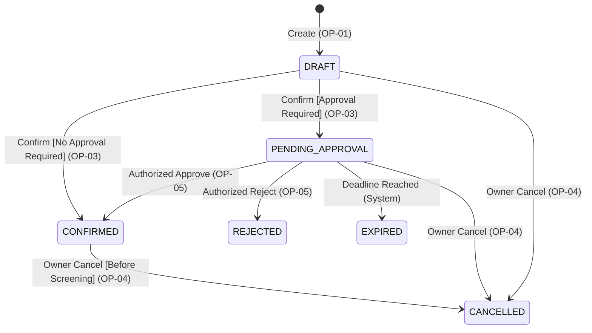

```markdown
# Specification Baseline v0.2 — Cinema Reservation System

**Team:** Deadlock  
**Domain:** Cinema Seat Reservation System  
**Baseline Version:** v0.2  
**Previous Baseline:** [Specification Baseline v0.1](../baseline_v0.1/c02_baseline_v0.1.md) (Preserved)  
**Change Source:** [Accepted C02 Change Impact Analysis](c02_change_impact.md)

---

## 1. Shared Domain Rules & Invariants

This section defines the updated domain invariants for Baseline v0.2, strengthening the concurrency and reservation lifecycle rules to accommodate the Approval Workflow.

### BR-01 — Resource Scope & Discrete Slot Semantics

- Unchanged from v0.1: A **Resource** is the discrete pair `(Screening, Seat)`, representing a physical seat reserved for a specific movie screening.
- Every `Screening` possesses a fixed UTC start time (`startTime`).
- Availability is strictly evaluated within the scope of a single screening.

### BR-02 — Exclusive Resource Invariant (No Double Booking)

For every discrete `(screeningId, seatId)` pair across all valid system states, the following invariant must strictly hold:

$$\text{count}(\text{reservations with state} \in \{\text{PENDING\_APPROVAL}, \text{CONFIRMED}\}) \le 1$$

- This strengthens v0.1: A `PENDING_APPROVAL` hold excludes both another pending hold and another confirmed allocation for the same resource.
- `DRAFT`, `CANCELLED`, `REJECTED`, and `EXPIRED` states do **not** block resources.
- Resource acquisition, hold conversion, and release are **atomic** across all seats within a reservation. Partial seat allocation is strictly prohibited.

### BR-03 — Domain-Specific Creation Horizon

- Unchanged from v0.1: Create is permitted strictly when $t_{\text{current}} \le t_{\text{screening\_start}} - 15\text{ minutes}$.
- Requests submitted less than 15 minutes before the start time are rejected (`409 Conflict`).

### BR-04 — Cancellation Policy

- Ownership restriction remains: Only the reservation owner may cancel.
- Eligible source states are expanded to `DRAFT`, `PENDING_APPROVAL`, and `CONFIRMED`.
- Cancellation is permitted strictly before the screening start time ($t_{\text{current}} < t_{\text{screening\_start}}$).
- Repeated cancellation attempts, or cancellation from terminal states (`CANCELLED`, `REJECTED`, `EXPIRED`), return `409 Conflict`.

### BR-05 — DRAFT and Resource Allocation

- `DRAFT` remains a non-binding customer intention that does not allocate resources or block seat availability.
- The exclusive allocation boundary is enforced during `Confirm Reservation`: it acquires either a final allocation (`CONFIRMED`) or a temporary hold (`PENDING_APPROVAL`).
- While a competing allocation persists, at most one conflicting draft can successfully transition out of `DRAFT`.

### BR-06 — Lifecycle Concurrency & Sequential Integrity

System state transitions must produce observable outcomes equivalent to a valid sequential ordering:

1. **Confirm vs. Cancel on DRAFT:** If `Cancel` succeeds first, `Confirm` is rejected. If `Confirm` succeeds first, the state becomes `CONFIRMED` or `PENDING_APPROVAL`; subsequent `Cancel` may succeed under BR-04.
2. **Approval vs. Cancel on PENDING_APPROVAL:** If `Cancel` succeeds first, approval is rejected. If `Approve` succeeds first, state becomes `CONFIRMED`; subsequent `Cancel` may cancel the confirmed reservation before screening start.
3. **Approval vs. Rejection:** Only the first valid decision leaves `PENDING_APPROVAL`. The second decision is rejected with `409 Conflict`.
4. **Approval vs. Expiration:** Approval is valid strictly before `approvalDeadline`. Once expiration is due ($t_{\text{current}} \ge \text{deadline}$), late approval cannot resurrect the hold.
5. **Stale Decision Protection:** Released seats may be acquired by a new reservation; an old delayed approval decision cannot alter the newly created allocation.

### BR-07 — Approval Applicability & Authority

- Certain seats (e.g., VIP seats) require approval by an **Authorized Approver**.
- Confirm evaluates approval policy:
  - If **no** resource requires approval $\rightarrow$ direct transition to `CONFIRMED`.
  - If **at least one** resource requires approval $\rightarrow$ entire reservation enters `PENDING_APPROVAL` and holds all seats atomically.
- Owning a reservation does not confer approval authority. Approval decisions require independent authorization.

### BR-08 — Pending Deadline, Release & Terminal Outcomes

- Each pending request is assigned a finite `approvalDeadline`:

$$\text{approvalDeadline} = \min(t_{\text{request}} + \text{timeout}, t_{\text{screening\_start}})$$

- Approval or rejection requires $t_{\text{current}} < \text{approvalDeadline}$ and $t_{\text{current}} < t_{\text{screening\_start}}$.
- At $t_{\text{current}} \ge \text{approvalDeadline}$, the request automatically transitions to `EXPIRED` and releases all held seats.
- `REJECTED`, `EXPIRED`, and `CANCELLED` are **terminal states**. They cannot be reopened, retried, or returned to `DRAFT`.

### BR-09 — Observable Approval Progress & Notifications

- The owner can observe the reservation state, request timestamp, `approvalDeadline`, decision status, and outcome timestamps.
- **Notification Boundary:** Final confirmation notifications are initiated **only** when a reservation enters `CONFIRMED` (via direct Confirm or Approve). Submitting a pending request does not dispatch a final confirmation notification.
- Rejection, cancellation, and expiration initiate their respective outcome notifications.

---

## 2. Specification of Baseline Operations

### OP-01 — Create Reservation
- **Goal:** Registered customer creates a non-binding `DRAFT` reservation.
- **Unchanged from v0.1:** Performs no conflict check and starts no approval request.
- **Result:** `201 Created` with a new `DRAFT` reservation.

### OP-02 — Check Availability
- **Goal:** User observes seat availability for a screening.
- **Updated Requirement (REQ-02):** A seat is marked `UNAVAILABLE` if it belongs to a `CONFIRMED` or unexpired `PENDING_APPROVAL` reservation. Otherwise, it is marked `AVAILABLE`.
- **Result:** `200 OK` with seat availability status. Read-only operation.

### OP-03 — Confirm Reservation
- **Goal:** Owner submits a draft for exclusive allocation.
- **Updated Requirement (REQ-03 & REQ-04):** 
  - If no selected seat requires approval $\rightarrow$ transitions to `CONFIRMED` and dispatches confirmation notification.
  - If any selected seat requires approval $\rightarrow$ transitions to `PENDING_APPROVAL`, assigns `approvalDeadline`, and holds all seats.
- **Preconditions:** Caller is owner, state is `DRAFT`, $t_{\text{current}} < t_{\text{screening\_start}}$, and no selected seat is held/allocated by another active reservation.
- **Error Outcomes:** Competing active hold or started screening $\rightarrow$ `409 Conflict`. Caller not owner $\rightarrow$ `403 Forbidden`.

### OP-04 — Cancel Reservation
- **Goal:** Owner withdraws a reservation before screening start.
- **Updated Requirement (REQ-05 & REQ-07):** Permits owner cancellation from `DRAFT`, `PENDING_APPROVAL`, or `CONFIRMED` states prior to screening start.
- **Result:** `200 OK`, state becomes `CANCELLED`, all seat holds/allocations are released, and cancellation notification is initiated.

### OP-05 — Approve / Reject Reservation (New Operation)
- **Goal:** Authorized Approver makes an independent decision on a `PENDING_APPROVAL` request.
- **Trigger:** Approver submits `POST /reservations/{id}/approval` with `decision = APPROVE` or `REJECT`.
- **REQ-08:** Only an Authorized Approver may execute this operation. Unauthorized attempts return `403 Forbidden`.
- **REQ-09 (APPROVE):** Positive decision transitions reservation to `CONFIRMED`, maintains seat allocations, and dispatches final confirmation notification.
- **REQ-10 (REJECT):** Negative decision transitions reservation to `REJECTED`, releases all seat allocations, and dispatches rejection notification.
- **REQ-11 (System Expiration):** If $t_{\text{current}} \ge \text{approvalDeadline}$, approval is rejected with `409 Conflict`, and system expiration transitions reservation to `EXPIRED`.

---

## 3. Reservation State Model (v0.2)

### Diagram Reference
Below is the graphical representation of the extended v0.2 state machine.

### State Diagram


### State Summary Table

| State | Meaning | Blocks Resources? | Terminal State? |
| --- | --- | --- | --- |
| **`DRAFT`** | Initial customer intention; non-binding | No | No |
| **`PENDING_APPROVAL`** | Submitted request awaiting decision; finite hold | Yes (until decision/deadline) | No |
| **`CONFIRMED`** | Final binding reservation | Yes | No (cancellable before screening) |
| **`REJECTED`** | Negative decision by Authorized Approver | No | **Yes** |
| **`EXPIRED`** | Approval deadline elapsed without decision | No | **Yes** |
| **`CANCELLED`** | Owner withdrawal before screening start | No | **Yes** |

---

## 4. REST API Mapping

| Operation | HTTP Method | Endpoint | Success Status |
| --- | --- | --- | --- |
| **Check Availability** | `GET` | `/screenings/{screeningId}/availability` | `200 OK` |
| **Create Reservation** | `POST` | `/reservations` | `201 Created` |
| **Confirm Reservation** | `POST` | `/reservations/{id}/confirm` | `200 OK` (`CONFIRMED` or `PENDING_APPROVAL`) |
| **Cancel Reservation** | `POST` | `/reservations/{id}/cancel` | `200 OK` (`CANCELLED`) |
| **Approve / Reject Reservation** | `POST` | `/reservations/{id}/approval` | `200 OK` (`CONFIRMED` or `REJECTED`) |

---

## 5. Requirements Acceptance Review

| Criterion | Resolution in Baseline v0.2 |
| --- | --- |
| **Clarity of Meaning** | Resource concept preserved; all 6 states (`DRAFT`, `PENDING_APPROVAL`, `CONFIRMED`, `REJECTED`, `EXPIRED`, `CANCELLED`) and blocking rules are explicitly defined. |
| **User Value** | Each operation states user/actor goals; Approver decision is independent of owner confirmation. |
| **Observable Outcome** | State, availability, approval deadline, and decision metadata are observable via status reads. |
| **Feasibility** | Drafts remain non-blocking; `PENDING_APPROVAL` and `CONFIRMED` enforce exclusive allocations under BR-02. |
| **Verifiability** | Comprehensive verification scenarios cover all paths, races, deadlines, and authority checks. |
| **Time Boundaries** | Boundaries $\le t_{\text{start}} - 15\text{m}$, $< t_{\text{start}}$, and $< \text{approvalDeadline}$ are strictly specified. |
| **Concurrency** | BR-06 and REQ-04 resolve confirmation collisions, decision races, and expiration/cancellation ordering. |
| **Consistency** | Unified rules BR-01 through BR-09 govern all operations and state transitions. |

---

## 6. Accepted Baseline v0.2 Decisions

1. Preserve non-blocking `DRAFT` creation and the 15-minute creation boundary.
2. `PENDING_APPROVAL` temporarily holds resources exclusively, excluding competing holds/allocations.
3. `Confirm` branches based on resource approval policy (direct `CONFIRMED` vs. `PENDING_APPROVAL`).
4. Approval is an independent operation requiring Authorized Approver privileges.
5. Pending reservations can be cancelled by the owner prior to screening start.
6. Rejection, expiration, and cancellation release all held resources while retaining historical records.
7. `REJECTED`, `EXPIRED`, and `CANCELLED` are terminal states.

```