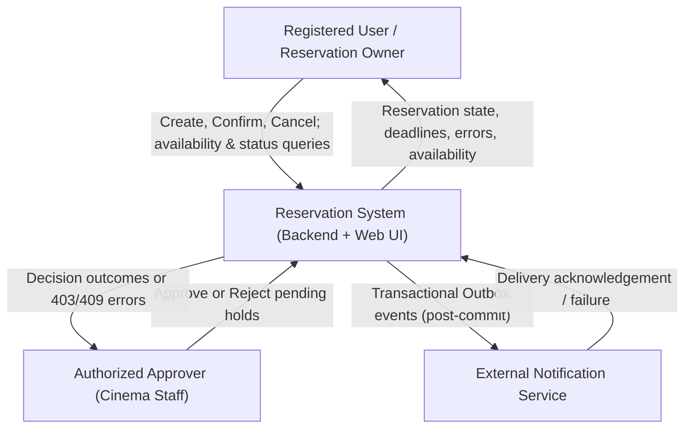
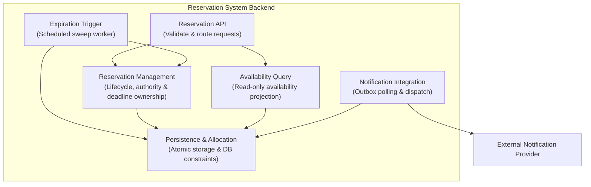
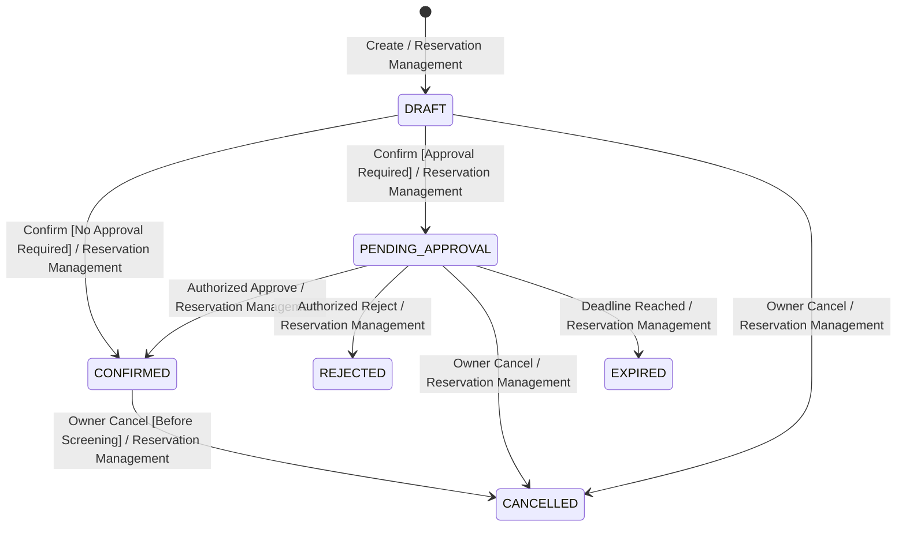
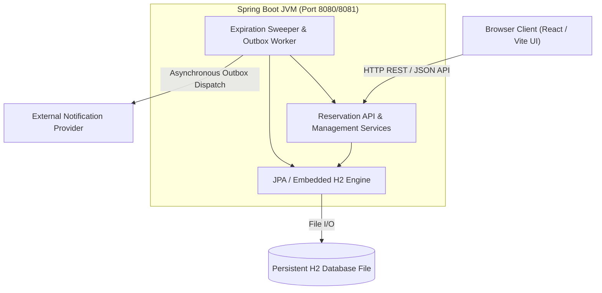

# C03 Target Architecture & Decision Specification — Cinema Reservation System

**Team:** Deadlock

**Domain:** Cinema Seat Reservation System

**Baseline Stage:** Baseline v0.2 / C03 Architecture (TO-BE Target & AS-IS Mapping)

**Selected Architectural Decision:** ADR-01 — Database-Enforced Exclusive Resource Allocation

---

## 1. Architectural Drivers (Section B)

The target architecture must satisfy specific technical and domain drivers derived from the Baseline v0.2 business rules and concurrency requirements.

| Driver | Source | Architectural Pressure | Question the Architecture Must Answer |
| --- | --- | --- | --- |
| **Atomic Exclusive Multi-Seat Allocation** | BR-02, REQ-03, REQ-04 | Concurrent confirmation requests must never acquire the same discrete `(Screening, Seat)` resource. Multi-seat reservations must be allocated atomically without partial acquisition. | Where must the authoritative allocation decision be enforced so that BR-02 is preserved under heavy concurrency? |
| **Persistent Delayed Approval Workflow** | BR-07, BR-08, REQ-08–REQ-12 | Reservations containing approval-required seats enter `PENDING_APPROVAL`. State snapshots, deadlines, policies, and decisions must survive process restarts. | Which logical element owns the pending approval state and governs subsequent lifecycle transitions? |
| **Reliable Expiration & Stale-Decision Protection** | BR-06, BR-08, REQ-11 | Pending holds must automatically expire at their deadline (`approvalDeadline`). Delayed decisions must never overwrite terminal or re-allocated states. | How is expiration authoritatively determined, and how are stale approval attempts prevented from corrupting active allocations? |
| **Lifecycle-Aligned Outbox Notifications** | BR-09, Notification Service | Notifications are initiated strictly post-commit following valid transitions (`CONFIRMED`, `CANCELLED`, `REJECTED`, `EXPIRED`). External provider downtime must not roll back committed business state. | How should notification dispatch be decoupled from application transactions, and who handles retry/idempotency? |

---

## 2. System Responsibilities & Ownership Matrix (Section C2)

To prevent conflicting lifecycle decisions and race conditions, each core system responsibility is assigned to exactly one logical element.

| Responsibility ID | System Responsibility | Managed State & Decision Boundary | Single Owner Required? | Architectural Justification |
| --- | --- | --- | --- | --- |
| **SR-01** | **Manage Reservation Lifecycle** | Valid lifecycle transitions (`DRAFT`, `PENDING_APPROVAL`, `CONFIRMED`, `REJECTED`, `EXPIRED`, `CANCELLED`). | **Yes** | Prevents conflicting or illegal state transitions across concurrent client requests. |
| **SR-02** | **Enforce Exclusive Resource Allocation** | Atomic creation, verification, and deletion of active resource allocations `(Screening, Seat)`. | **Yes** | Concurrency must not result in double booking or partial seat acquisition. |
| **SR-03** | **Manage Approval Authority & Decisions** | Verification of Authorized Approver privileges (`X-User-Id` / role) and execution of `APPROVE`/`REJECT`. | **Yes** | Approval is an independent, delayed managerial action separate from reservation ownership. |
| **SR-04** | **Manage Pending Expiration** | Evaluation of `approvalDeadline` and automated `PENDING_APPROVAL` $\rightarrow$ `EXPIRED` transitions. | **Yes** | Time-driven expiration must guarantee predictable hold release without indefinite resource lockup. |
| **SR-05** | **Provide Coherent Availability** | Projection of `AVAILABLE` / `UNAVAILABLE` seat statuses for a screening. | **Yes** | Availability views must accurately reflect active holds, confirmed seats, and due expiration in real time. |
| **SR-06** | **Deliver Lifecycle Notifications** | Asynchronous dispatch, retry tracking, and failure recovery for external notifications. | **Yes** | Decouples third-party notification availability from database commit guarantees. |

---

## 3. Architecture Decision Question & Trade-Off Analysis (Sections D, E1–E3)

### Decision Question

*Where should the authoritative confirmation and Resource allocation decision be made so that BR-02 (Exclusive Resource Invariant) is strictly preserved under concurrent `Confirm` requests?*

### Architectural Alternatives

* **Alternative A — Application-Controlled Allocation:**
The Reservation Application owns both the confirmation logic and resource exclusivity enforcement. The application checks for allocation collisions in memory or via read queries before persisting changes within an application-managed transaction.
* **Alternative B — Database-Enforced Exclusive Allocation (Selected):**
The Reservation Application manages workflow rules and state transitions, while the database authoritatively enforces resource exclusivity at the persistence boundary. Concurrent conflicting allocations are rejected by relational database constraints and mapped to `409 Conflict`.

### Comparative Evaluation Matrix

| Driver / Evaluation Criterion | Alternative A — Application-Controlled Allocation | Alternative B — Database-Enforced Allocation (Selected) |
| --- | --- | --- |
| **Atomic Multi-Seat Exclusivity** | Relies on complex application locking (e.g., coarse pessimistic locks). Prone to race conditions if any code path bypasses locking. | Enforced directly at the relational layer via unique constraints. Guaranteed protection against concurrent double booking. |
| **Concurrency & Invariant Preservation** | High risk of Read-Then-Write vulnerabilities (TOCTOU) unless explicitly synchronized across all application nodes. | Relational database engine guarantees atomicity and isolation; losing concurrent writes fail at commit time. |
| **Lifecycle Ownership** | Keeps workflow and allocation logic tightly grouped within application services. | Clear separation: Application owns lifecycle workflow; Database owns final resource exclusivity enforcement. |
| **Implementation Complexity** | Simple initial queries, but high operational complexity when scaling horizontally or managing fine-grained locks. | Requires persistence mapping, transactional rollback handling, and exception translation (`DataIntegrityViolation` $\rightarrow$ `409`). |

### Scenario Walkthrough (C02 Verification Scenario V-09)

*Two conflicting `DRAFT` reservations (R1 and R2) attempt to confirm overlapping Seat A1 concurrently.*

```text
[Client 1 (R1)] --------> (POST /confirm) ----\
                                               +---> [Reservation Application]
[Client 2 (R2)] --------> (POST /confirm) ----/               |
                                                              | Atomic Acquisition Attempt
                                                              v
                                              +-------------------------------+
                                              | Database Engine               |
                                              | UNIQUE (screening_id, seat_id)|
                                              +-------------------------------+
                                                              |
                   +------------------------------------------+------------------------------------------+
                   |                                                                                     |
         [First Transaction Commits]                                                           [Second Transaction Violates Constraint]
                   |                                                                                     |
                   v                                                                                     v
      Allocation Created: Seat A1                                                           Database Rejects Insertion (Constraint Violation)
     State -> PENDING_APPROVAL / CONFIRMED                                                  Application Catches Exception & Rolls Back Transaction
         Returns HTTP 200 OK                                                                Returns HTTP 409 Conflict (R2 remains DRAFT)

```

---

## 4. Architecture Decision Record (Section F)

### ADR-01 — Authoritative Resource Allocation under Concurrent Confirmation

* **Context:** Concurrent `Confirm Reservation` requests may attempt to acquire overlapping physical seats for the same screening. The system must enforce BR-02 so that a discrete `(Screening, Seat)` resource belongs to at most one active `PENDING_APPROVAL` or `CONFIRMED` reservation. Multi-seat allocations must be completely atomic.
* **Drivers:** Atomic exclusive multi-seat allocation; preservation of BR-02 under concurrent HTTP requests; clear responsibility boundaries; prevention of TOCTOU race conditions.
* **Selected Decision:** **Alternative B — Database-Enforced Exclusive Allocation.**
* **Rationale:** BR-02 is a core domain invariant. Enforcing resource exclusivity at the database boundary guarantees that even under distributed or multi-instance execution, concurrent conflicting transactions cannot both commit active allocations. The application manages state machines and business logic, while the database provides absolute exclusivity enforcement.
* **Accepted Negative Consequences:**
* Persistence logic is coupled to relational database constraint mechanisms.
* Persistence exceptions must be explicitly translated into domain outcomes (`409 Conflict`).
* Multi-seat reservations require strict transactional rollback to prevent partial seat holds.


* **Reconsideration Triggers:**
* Migration to a non-relational distributed database lacking multi-row unique constraints.
* Measured database lock contention under extreme horizontal scaling.


---

## 5. Architectural Views (Section G)

### G1 — System Context View

The Reservation System acts as a single bounded context managing cinema seat availability and booking lifecycles.



### G2 — Static Architecture View

Six logical elements encapsulate the system responsibilities. All elements reside within a single backend deployable.



| Logical Element | Primary Responsibility | Managed State & Invariants |
| --- | --- | --- |
| **Reservation API** | Transport validation, HTTP routing, identity forwarding (`X-User-Id`), and DTO mapping. | Holds no domain state. |
| **Reservation Management** | Executes state transitions (`Create`, `Confirm`, `Cancel`, `Approve`, `Reject`, `Expire`). Enforces ownership, approver authority, and time boundaries. | Single decision owner of `Reservation.state`, deadline snapshots, and lifecycle history. |
| **Availability Query** | Computes real-time `AVAILABLE` / `UNAVAILABLE` seat availability maps for screenings. | Implements REQ-02 projection rules; read-only surface. |
| **Expiration Trigger** | Periodic background task discovering due pending holds ($t_{\text{current}} \ge \text{deadline}$). | Triggers reconciliation calls into Reservation Management. |
| **Persistence & Allocation** | Manages database entities, active allocation tables, pessimistic locks, unique constraints, and Outbox records. | Database-level enforcement of BR-02 via `UNIQUE(screening_id, seat_id)`. |
| **Notification Integration** | Reads committed Outbox entries and handles external HTTP dispatch, retries, and exponential backoff. | Outbox delivery status, attempt counts, and idempotency keys. |

### G3 — State Transition Ownership View



### G4 — Runtime & Deployment View



---

## 6. AS-IS vs. TO-BE Delta & Transformation Matrix (Section J)

The following delta table defines the refactoring work packages required to transition the legacy codebase to the target C03 architecture.

| Delta ID | Functional Area | AS-IS Code Base State | TO-BE Target Architecture State | Required Action | Completion Criterion |
| --- | --- | --- | --- | --- | --- |
| **J-01** | **Exclusive Acquisition** | Conflict checks rely on application-level `countOtherAllocations()` query under a coarse screening lock. | Dedicated `active_allocation` database table with `UNIQUE(screening_id, seat_id)` constraint. | **CHANGE** | Database natively rejects duplicate active seat insertions across concurrent transactions. |
| **J-02** | **Atomic Allocation** | Single reservation status column implicitly represents seat hold status. | Multi-seat confirm inserts all seats into `active_allocation` within a single database transaction. | **CHANGE** | Allocation collision on any single seat rolls back the entire reservation attempt cleanly. |
| **J-03** | **Hold Conversion & Release** | Status updates perform manual cleanup queries. | Approval converts holds in place; cancellation, rejection, and expiration delete active allocation rows. | **CHANGE** | Terminal transitions immediately free seat rows while retaining historical reservation audit records. |
| **J-04** | **Conflict Exception Mapping** | Application throws generic `ReservationException(CONFLICT)`. | Database constraint violations (`DataIntegrityViolationException`) are caught and mapped to `409 Conflict`. | **CHANGE** | Failed acquisition attempts return clean `HTTP 409 Conflict` without corrupting transaction state. |
| **J-05** | **Notification Outbox** | Synchronous post-commit Spring event listener (`ApplicationEventPublisher`). | Transactional Outbox pattern with dedicated worker reading persisted event table. | **CHANGE** | Notifications are persisted atomically with state updates and dispatched asynchronously with retry. |
| **J-06** | **Lifecycle Ownership Isolation** | State logic split across controllers, services, and entity methods. | All lifecycle transitions consolidated strictly within `Reservation Management`. | **VERIFY** | Controllers and external triggers never mutate entity status directly. |
| **J-07** | **Independent Expiration** | System sweep shares transaction context with pre-read endpoints. | Independent expiration reconciliation transactions running under `PESSIMISTIC_WRITE` locks. | **CHANGE** | Failed client commands cannot roll back an independent system expiration decision. |
| **J-08** | **Availability Projection** | Availability queries read reservation state tables directly. | Availability Query joins physical seats against active allocations and pending due deadlines. | **CHANGE** | Read-only availability accurately reflects live holds and automatically filters due expirations. |
| **J-09** | **Core Domain Preservation** | Baseline v0.1/v0.2 business rules implemented. | Preserve all existing business rules BR-01 through BR-09 and API contracts. | **KEEP** | 100% pass rate on all 74 existing regression tests. |
| **J-10** | **Runtime Infrastructure** | Single Spring Boot backend + embedded H2 + React frontend. | Retain single-JVM backend process model and file-backed H2 persistence. | **KEEP** | Simple local deployment model preserved without adding complex microservices. |
| **J-11** | **Local Port Alignment** | Frontend Vite proxy configured for 8080; backend dev profile launched on 8081. | Unified port configuration across Vite proxy and Spring Boot `application.yaml`. | **CHANGE** | Frontend seamlessly routes API requests without CORS or proxy errors. |
| **J-12** | **Architecture Conformance Check** | No automated layer isolation checker in CI pipeline. | Executable Python checker script (`check_architecture.py`) enforcing controller dependency rules. | **CHANGE** | Script verifies controllers do not import persistence repositories or JPA packages. |

---

## 7. Architecture Conformance & Verification (Section L2)

To ensure long-term architectural integrity, the repository includes an automated architecture checking script (`backend/check_architecture.py`).

### Conformance Rule

*REST Controllers (`com.reservedbytes.cinema_reservation.controller`) must not directly import or depend on JPA Repositories, Spring Data classes, or persistence entities. All requests must route exclusively through Application Services (Reservation Management / Availability Query).*

### Verification Execution & Results

Running the architecture checker against the codebase:

```text
$ python backend/check_architecture.py .
PASS: 2 controller files; no direct persistence dependencies.

```