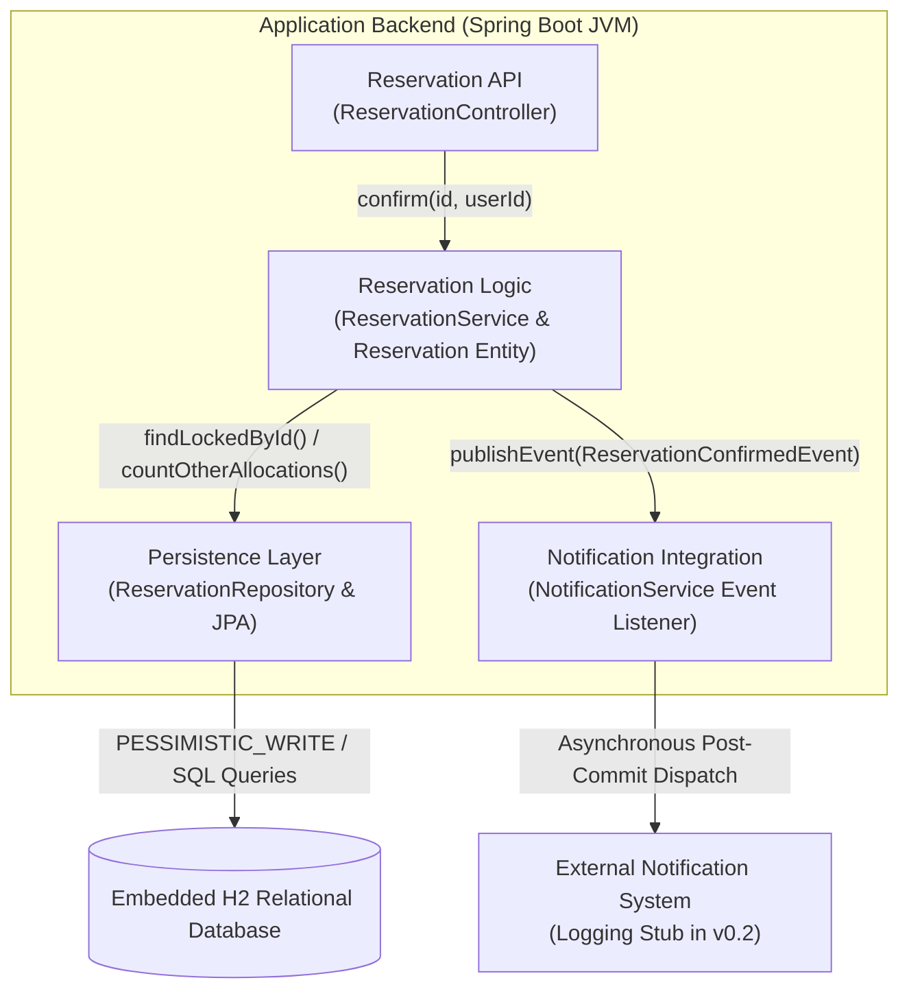

```markdown
# C03 Part A — AS-IS System Mapping & Code Analysis

**Team:** Deadlock  
**Domain:** Cinema Seat Reservation System  
**Document Purpose:** Baseline v0.2 AS-IS Implementation Analysis & Code Traceability

---

## 1. Selected Scenario & Scope

| Item | Value |
| :--- | :--- |
| **Scenario / Operation** | `Confirm Reservation` (OP-03) |
| **Requirements** | `REQ-03` (Collision Check), `REQ-04` (Concurrency Safety) |
| **Domain Rules / Invariants** | `BR-02` (Exclusive Resource Invariant) |
| **Baseline Alignment** | Baseline v0.2 (Runnable State) |

---

## 2. Main Success Scenario Mapping to Source Code

The following matrix traces the logical execution steps of `Confirm Reservation` (OP-03) directly to the concrete Java backend implementation files.

| Scenario Step (C02 Specification) | Code Implementation Method | Class / Source File Location |
| :--- | :--- | :--- |
| **1. Receive Confirmation Request** | `confirmReservation(@PathVariable Long id)` | `controller/ReservationController.java` |
| **2. Acquire Screening Lock & Load Reservation** | `findLockedById(Long screeningId)` <br> `findById(Long id)` | `repository/ScreeningRepository.java` <br> `service/ReservationService.java` |
| **3. Validate Transition Preconditions** | `reservation.getStatus() == ReservationStatus.DRAFT` <br> `currentTime < screening.getStartTime()` | `service/ReservationService.java` |
| **4. Evaluate Seat Approval Policy** | `approvalPolicy.requiresApproval(seat)` | `service/ApprovalPolicy.java` |
| **5. Evaluate Allocation Conflicts (BR-02)** | `reservationRepository.countOtherAllocations(...)` | `repository/ReservationRepository.java` |
| **6. Perform Atomic State Transition** | `reservation.confirm()` OR `reservation.pendingApproval(...)` | `model/Reservation.java` (Domain Entity) |
| **7. Persist Resulting State** | Explicit dirty-checking via transactional commit (`@Transactional`) | `service/ReservationService.java` |
| **8. Dispatch Post-Commit Notification** | `eventPublisher.publishEvent(new ReservationConfirmedEvent(...))` | `service/NotificationService.java` |

---

## 3. Alternative & Failure Branch Mapping

**Selected Failure Branch:** Allocation Collision Detected (`BR-02` Violation) $\rightarrow$ Confirmation Rejected.

| Scenario Rule (v0.2) | Condition Detection Location | Decision & Outcome Logic | Client HTTP Result |
| :--- | :--- | :--- | :--- |
| **Collision Detected** | `ReservationService.java` evaluates `countOtherAllocations(...) > 0`. | Throws `ReservationException(HttpStatus.CONFLICT, "Seats already allocated")`. | Returns `HTTP 409 Conflict`. Reservation state remains `DRAFT`. |
| **Unauthorized Decision** | `ReservationService.java` verifies caller identity `X-User-Id`. | Throws `ReservationException(HttpStatus.FORBIDDEN, "User lack approver authority")`. | Returns `HTTP 403 Forbidden`. Pending hold unchanged. |

---

## 4. AS-IS Structural Components

| Component Name | Class / Implementation Type | Role in Executed Scenario | File Reference |
| :--- | :--- | :--- | :--- |
| **Reservation API** | `ReservationController` | REST Controller accepting HTTP requests and mapping DTOs. | `controller/ReservationController.java` |
| **Reservation Logic** | `ReservationService`, `Reservation` | Executes state machine transitions, validates rules, manages locks. | `service/ReservationService.java`, `model/Reservation.java` |
| **Persistence Layer** | `ReservationRepository`, `ScreeningRepository` | Communicates with the embedded H2 relational database via JPA. | `repository/*.java` |
| **Notification Integration** | `NotificationService` | Subscribes to Spring application events post-commit and logs outputs. | `service/NotificationService.java` |

---

## 5. Persistent State & Invariant Enforcement

### Persistent State Ownership
* **Where is Reservation state stored?**  
  Persisted in an embedded H2 relational database table (`reservations`) via Spring Data JPA.
* **Which component executes state changes?**  
  `ReservationService` guards preconditions; the `Reservation` domain entity updates its internal `ReservationStatus` enum field.

### Business Rule Enforcement (BR-02)
* **Where is the rule condition checked?**  
  Application layer query via `ReservationRepository.countOtherAllocations(...)`.
* **Where is the outcome decided?**  
  Inside `ReservationService.confirm()` prior to modifying entity state.
* **Where is the resulting change persisted?**  
  In-memory entity mutation persisted upon JPA transaction commit (`@Transactional`).

---

## 6. External System Dependencies

| Dependency | Code Integration Point | Component Managing Technical API | File / Config Source |
| :--- | :--- | :--- | :--- |
| **Relational Database** | JDBC / Spring Data JPA | `ReservationRepository`, `ScreeningRepository` | `application.yaml` |
| **Notification Service** | `@TransactionalEventListener` | `NotificationService` (In-process logging stub) | `service/NotificationService.java` |

---

## 7. AS-IS Structural Diagram



---

## 8. Transition Question for Architectural Refactoring (C03)

| Item | Description |
| --- | --- |
| **Key Architectural Question** | *Where and how must the authoritative allocation decision be enforced so that invariant BR-02 is strictly preserved under concurrent HTTP requests, eliminating application-level race conditions?* |
| **Observed AS-IS Vulnerability** | In the current implementation, `countOtherAllocations()` (Read) and `reservation.setStatus()` (Write) are separate logic steps within application memory. Although guarded by a coarse `PESSIMISTIC_WRITE` screening lock, this creates a potential Time-of-Check to Time-of-Use (TOCTOU) bottleneck and relies entirely on application-level locking rather than database exclusivity guarantees. |
| **Why It Matters** | Under heavy parallel requests, application locks can degrade throughput or be accidentally bypassed by new API endpoints. Moving resource exclusivity to a relational database constraint (`UNIQUE(screening_id, seat_id)`) guarantees BR-02 at the persistence boundary (ADR-01). |

```