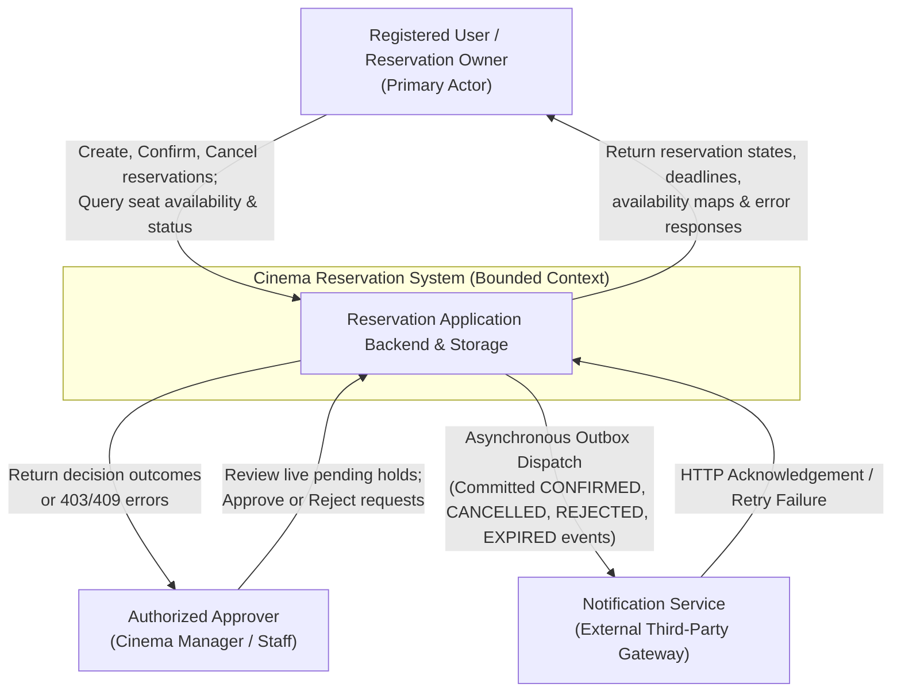

```markdown
# G1 — System Context View

**Team:** Deadlock  
**Domain:** Cinema Seat Reservation System  
**View Purpose:** High-Level External System Boundaries, Actors, and External System Interfaces (TO-BE Target)

---

## 1. Description & Context Boundary

The **Cinema Reservation System** acts as an isolated bounded context managing physical seat availability, customer reservation lifecycles, and manager approval workflows for cinema screenings.

* **Included in Boundary:** React/Vite Frontend, Spring Boot REST API, Domain Rules Engine, Transactional Outbox, and Persistent Relational Database (H2/PostgreSQL).
* **Excluded from Boundary:** External Notification Provider (SMS/Email Gateway), External User Identity Providers, and Physical Box-Office Ticket Printing.

---

## 2. Context Diagram (Mermaid)



---

## 3. Actor Privileges & System Responsibilities

| Actor / External System | System Privilege & Interaction Boundary | Authority Rules (v0.2) |
| --- | --- | --- |
| **Registered User** | Creates `DRAFT` proposals, executes `Confirm` requests, queries availability, and cancels owned reservations. | Ownership verification (`X-User-Id`). Cannot approve pending holds. |
| **Authorized Approver** | Inspects reservations in `PENDING_APPROVAL` and submits `APPROVE` or `REJECT` decisions (OP-05). | Requires explicit Approver role over target seat classifications (BR-07). |
| **Notification Service** | Receives committed outbox payload events via asynchronous HTTP POST. | External boundary. Provider failure does not roll back database transactions (ADR-02). |

```