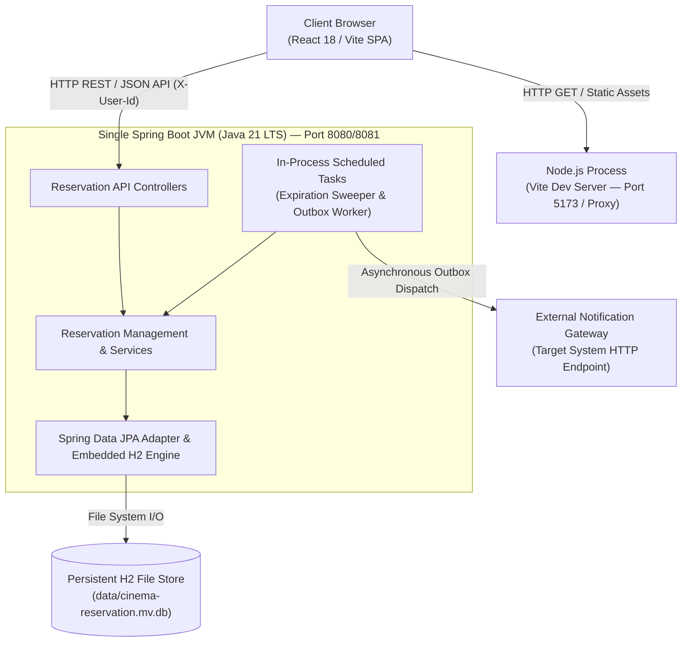

# G4 — Runtime & Deployment Mapping View

**Team:** Deadlock  
**Domain:** Cinema Seat Reservation System  
**View Purpose:** Mapping Logical Architecture Elements to Physical Processes, Deployment Artifacts, and Ports

---

## 1. Process & Topology Diagram (Mermaid)

---

## 2. Logical Element to Runtime Execution Mapping

| G2 Logical Component | Runtime Artifact / Process | Threading & Persistence Behavior |
| --- | --- | --- |
| **Reservation API** | Spring Boot JVM (`@RestController`) | Executes synchronously on Tomcat HTTP worker threads. Stateless. |
| **Reservation Management** | Spring Boot JVM (`@Service`) | Executes within Spring `@Transactional` boundaries under `PESSIMISTIC_WRITE` locks. |
| **Availability Query** | Spring Boot JVM (`@Service`) | Read-only database transaction querying active allocations and pending deadlines. |
| **Expiration Trigger** | Spring Boot JVM (`@Scheduled`) | Single-threaded background execution sweeping due pending holds every 1000ms. |
| **Persistence & Allocation** | Embedded H2 Relational Engine | In-process file-backed storage (`dev` profile uses disposable in-memory H2). |
| **Notification Integration** | Spring Boot JVM (`@Scheduled` Outbox Worker) | Background polling worker claiming committed outbox records and handling retries. |

---

## 3. Operational Setup & Port Configuration

* **Backend HTTP Port:** Running on `8081` (`dev` profile) or `8080` (`default` profile).
* **Frontend Vite Dev Server:** Port `5173` (proxies `/api` requests to backend port).
* **Database Target:** Embedded H2 database engine running in-process inside the Spring Boot JVM.
