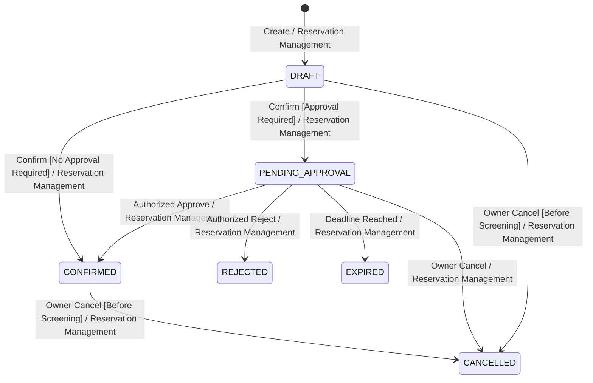

```markdown
# G3 — State Transition Ownership View

**Team:** Deadlock  
**Domain:** Cinema Seat Reservation System  
**View Purpose:** Mapping Reservation Lifecycle Transitions to Single Decision Owners and System Guards

---

## 1. Statechart Diagram (Mermaid)



---

## 2. Transition Guard & Decision Ownership Table

| Source State $\rightarrow$ Target State | Decision Owner | Triggering Actor / Source | Required System Guards & Atomic Side Effects |
| --- | --- | --- | --- |
| **$[*] \rightarrow$ `DRAFT**` | Reservation Management | Registered User via `POST /reservations` | Valid user/screening/seats; $t_{\text{current}} \le t_{\text{start}} - 15\text{m}$ (BR-03). Persists non-blocking draft. |
| **`DRAFT` $\rightarrow$ `CONFIRMED**` | Reservation Management | Reservation Owner via `POST /reservations/{id}/confirm` | Owner match; state is `DRAFT`; $t_{\text{current}} < t_{\text{start}}$; no selected seat requires approval. DB acquires seats atomically (`ADR-01`). Dispatches confirmation outbox event. |
| **`DRAFT` $\rightarrow$ `PENDING_APPROVAL**` | Reservation Management | Reservation Owner via `POST /reservations/{id}/confirm` | Same ownership/time/conflict guards; at least one seat requires approval (VIP). DB acquires holds atomically; assigns `approvalDeadline` (BR-08). |
| **`PENDING_APPROVAL` $\rightarrow$ `CONFIRMED**` | Reservation Management | Authorized Approver via `POST /reservations/{id}/approval` | Approver authority over target seats (BR-07); state is `PENDING_APPROVAL`; $t_{\text{current}} < \text{deadline}$. Holds converted in place. Dispatches confirmation outbox event. |
| **`PENDING_APPROVAL` $\rightarrow$ `REJECTED**` | Reservation Management | Authorized Approver via `POST /reservations/{id}/approval` | Same pending/authority/deadline guards. Releases seat allocations; records decision metadata. Dispatches rejection outbox event. |
| **`PENDING_APPROVAL` $\rightarrow$ `EXPIRED**` | Reservation Management | Expiration Trigger / System Reconciliation | State is `PENDING_APPROVAL`; $t_{\text{current}} \ge \text{approvalDeadline}$. Releases seat allocations automatically. Dispatches expiration outbox event. |
| **`DRAFT` / `PENDING` / `CONFIRMED` $\rightarrow$ `CANCELLED**` | Reservation Management | Reservation Owner via `POST /reservations/{id}/cancel` | Owner match; eligible state; $t_{\text{current}} < t_{\text{start}}$ (BR-04). Releases seat allocations if present. Dispatches cancellation outbox event. |

---

## 3. Terminal State Invariants

* **`CANCELLED`**, **`REJECTED`**, and **`EXPIRED`** are immutable terminal states.
* No outgoing transitions exist from terminal states. Stale commands or late approval attempts on terminal reservations return `HTTP 409 Conflict`.

```