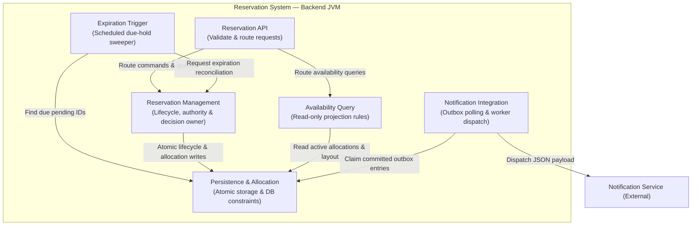

```markdown
# G2 — Static Architecture View

**Team:** Deadlock  
**Domain:** Cinema Seat Reservation System  
**View Purpose:** Logical Component Decomposition, Responsibility Assignment, and Internal Dependencies

---

## 1. Description & Element Decomposition

The system is organized into six logical backend components residing within a single Spring Boot application artifact.



---

## 2. Component Responsibility Matrix

| Logical Element | Primary Architectural Responsibility | Managed State & Invariants |
| --- | --- | --- |
| **Reservation API** | Validates HTTP transport payloads, extracts caller identity headers (`X-User-Id`), routes requests, and maps domain exceptions to HTTP status codes. | Holds no persistent domain state. |
| **Reservation Management** | Executes core lifecycle transitions (`Create`, `Confirm`, `Cancel`, `Approve`, `Reject`, `Expire`). Enforces ownership, approver privileges, creation horizons (BR-03), and time limits. | Single decision owner of `Reservation.status`, deadline snapshots, and decision history. |
| **Availability Query** | Computes real-time `AVAILABLE` / `UNAVAILABLE` seat availability maps for screenings under REQ-02. | Read-only projection layer; does not mutate domain state. |
| **Expiration Trigger** | Scheduled background sweeper discovering pending reservations where $t_{\text{current}} \ge \text{approvalDeadline}$. | Manages sweep scheduling; delegates expiration execution to Reservation Management. |
| **Persistence & Allocation** | Handles database mapping, active allocation tables, pessimistic locks, unique keys, and Outbox persistence. | Database-level enforcement of BR-02 via `UNIQUE(screening_id, seat_id)` (ADR-01). |
| **Notification Integration** | Reads committed outbox records and manages HTTP dispatch, retry counters, and exponential backoff. | Outbox dispatch status, retry timestamps, and idempotency headers (ADR-02). |

---

## 3. Allocation Enforcement Mechanism (ADR-01 Realization)

* Active seat allocations are managed in a dedicated relational mapping table `active_allocation` with a database unique key `UNIQUE(screening_id, seat_id)`.
* Confirmation inserts seat rows atomically. A constraint violation triggers a relational rollback, translated by Reservation Management into `HTTP 409 Conflict`.
* Approval converts pending holds to confirmed allocations without deleting seat rows (zero release window).
* Cancellation, rejection, and expiration delete `active_allocation` rows for the target reservation ID, immediately freeing resources.

```