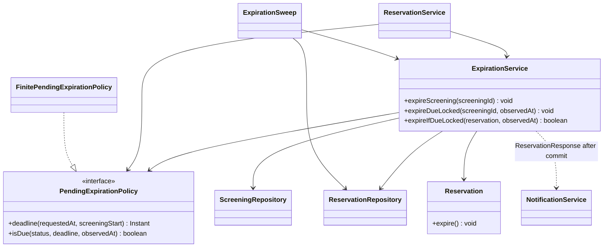

# C05 — Manage Pending Expiration: detailed design

Team Deadlock. AS-IS source baseline: `efef609615aed90aae3851d9a7e205345e862cb2`; documentation restored on 2026-11-16. This describes implemented behavior, not a new architecture or a new test run. Official C05 assignment text is unavailable in this workspace; completeness against that assignment remains unconfirmed.

## Purpose and architectural scope

The selected unit ends finite approval holds without allowing a late approval to resurrect an expired reservation. It belongs to reservation management in the existing Spring service/JPA architecture. Controllers delegate to services; services coordinate screening locks, managed entities and Spring events. All seats in one pending reservation share its lifecycle.

Read the [contracts](DESIGN_CONTRACTS.md), [time policy](EXPIRATION_POLICY.md) and [runtime sequences](EXPIRATION_SEQUENCE.md) together. Architectural context is the existing [static view](../03_architecture/views/STATIC_VIEW.md) and [ADR-01](../03_architecture/decisions/ADR-01_EXCLUSIVITY.md); architectural targets are not assertions about runtime implementation.

## Responsibilities and design decisions

Java paths below are relative to `backend/src/main/java/com/reservedbytes/cinema_reservation/`.

| ID | Responsibility / decision | Implemented owner and evidence |
|---|---|---|
| D1 | Reject missing/non-positive timeout configuration | `service/FinitePendingExpirationPolicy.java`, constructor |
| D2 | Compute a finite deadline capped at screening start; compare durations before adding to avoid overflow | `FinitePendingExpirationPolicy.deadline` |
| D3 | Only pending holds expire; exact deadline is already due | `FinitePendingExpirationPolicy.isDue` |
| D4 | Acquire screening `PESSIMISTIC_WRITE` before loading pending entities; use a clock snapshot for each batch | `service/ExpirationService.java`, `repository/ScreeningRepository.java` |
| D5 | Set `EXPIRED` and effective `expiredAt = approvalDeadline` | `model/Reservation.java`, `expire` |
| D6 | Publish a `ReservationResponse` only when a transition occurs; log after commit | `ExpirationService.expireIfDueLocked`, `service/NotificationService.java` |

`PendingExpirationPolicy` isolates pure decisions from persistence. `ExpirationService` centralizes guarded mutation. `ExpirationSweep` discovers distinct screening IDs containing pending reservations and invokes the transactional service once per screening. `ReservationService` also reconciles on commands and availability. The reservation GET controller calls `resolveExpiration` before its separate read transaction.

## Data flow and failures

Confirm captures the request time and stores the computed deadline when approval is needed. Expiration later reads status/deadline from managed reservations under the screening lock. A due transition changes status and timestamp; JPA dirty checking persists it at commit. Seat associations remain as history: release means the reservation ceases to match allocation queries, not deletion of seat rows.

Availability reconciles and projects using the same `observedAt`. Confirm, cancel and approval reconcile under the shared lock; cancel and approval also recheck the target with a later clock snapshot. Invalid authority/input checks can occur before reconciliation. GET reconciliation and reading are separate transactions, so they do not provide one atomic observation snapshot.

Missing screening in the worker is a no-op. Invalid policy inputs fail fast. Lock/database/event-publication failures are not caught by the expiration service or sweep; normal Spring transaction rollback rules apply. Lifecycle commands explicitly use `noRollbackFor = ReservationException.class`, allowing reconciliation to commit despite a business rejection. See contracts for limits of the guarantees.

## AS-IS versus TO-BE and risks

AS-IS uses state-based allocation queries and coarse screening locks. There is no separate active-allocation uniqueness table, durable outbox, notification retry or public expiration endpoint. Those architecture ideas remain TO-BE. Repeated guarded execution does not emit a second event for an already expired entity; this is not a durable exactly-once delivery guarantee.

The sweep is best effort; prompt reconciliation on supported request paths protects deadline decisions independently of its interval. The scheduler does not guarantee execution at the deadline. Lock contention, process failure after commit, clock skew and database timestamp precision remain limitations. Nanosecond tests prove Java policy behavior, not database precision on every platform.

## Verification traceability and DD/code comparison

All three test classes below use package `com.reservedbytes.cinema_reservation`, under `backend/src/test/java/com/reservedbytes/cinema_reservation/`.

| DD element | Existing class and exact method | Oracle / level |
|---|---|---|
| D1 | `PendingExpirationPolicyTests.rejectsNonPositiveOrMissingConfiguration` | Invalid configuration rejected; unit |
| D2 | `PendingExpirationPolicyTests.usesTimeoutWhenScreeningIsLater` | Request plus timeout; unit |
| D2 | `PendingExpirationPolicyTests.capsDeadlineAtScreeningIncludingEquality` | Cap including equality; unit |
| D2 | `PendingExpirationPolicyTests.handlesHugeTimeoutWithoutInstantOverflow` | Huge timeout safely capped; unit |
| D2 | `PendingExpirationPolicyTests.rejectsRequestAtOrAfterStart` | Illegal request time rejected; unit |
| D3 | `PendingExpirationPolicyTests.expiresExactlyAtDeadlineWithNanosecondPrecision` | Before/at/after boundary; unit |
| D3 | `PendingExpirationPolicyTests.neverExpiresNonPendingStates` | Non-pending states unchanged; unit |
| Contracts | `PendingExpirationPolicyTests.failsFastOnMissingRequiredInputs` | Null handling; unit |
| D5/D6 | `ExpirationServiceTests.dueTransitionKeepsEffectiveDeadlineAndPublishesOnce` | Effective time and one response event; unit |
| D3 | `ExpirationServiceTests.livePendingDoesNotMutateOrNotify` | Live hold unchanged; unit |
| D4 | `ExpirationServiceTests.batchObtainsLockBeforeLoadingPendingAndUsesClock` | Mock call order and fixed clock; unit |
| D4 | `ExpirationServiceTests.missingScreeningIsNoOp` | No pending query/event for absent screening; unit |
| D4–D6 | `ReservationIntegrationTests.c05RepeatedWorkerCommitsOneExpirationAndReleasesWholeHold` | Repeated `expireScreening` calls release all seats and notify once; integration |
| D5/D6 | `ReservationIntegrationTests.c05RollbackRestoresPendingAndSuppressesExpirationNotification` | `setRollbackOnly()` restores pending and suppresses listener; integration |

The boundary test belongs at unit level because explicit `Instant` inputs isolate pure time mathematics. The rollback test requires Spring/JPA/H2 integration because mocks cannot prove transaction rollback or after-commit suppression. It marks rollback explicitly; it does not throw an unhandled exception. The worker test calls the service directly; it does not test scheduler timing.

The [DD-derived test inventory](../05_verification_and_quality/DD_DERIVED_TESTS.md) and [historical design/checker document](../05_verification_and_quality/ARCHITECTURE_CHECKER.md) retain historical evidence. Their 74-test transcript is historical, not a test result of this documentation repair. Corrections to interpret those records: the test package is as stated above; the event type is `ReservationResponse`; rollback uses `setRollbackOnly()`. The referenced `backend/check_architecture.py` is absent, so that checker result cannot be reproduced here and does not prove all dependency routes comply.

D1–D6 match the present source; no application changes were needed. The remaining design delta is documentation/evidence recovery, not implementation of active allocations or an outbox. Official assignment conformity and any fresh runtime verification remain distinct from source/test traceability.
