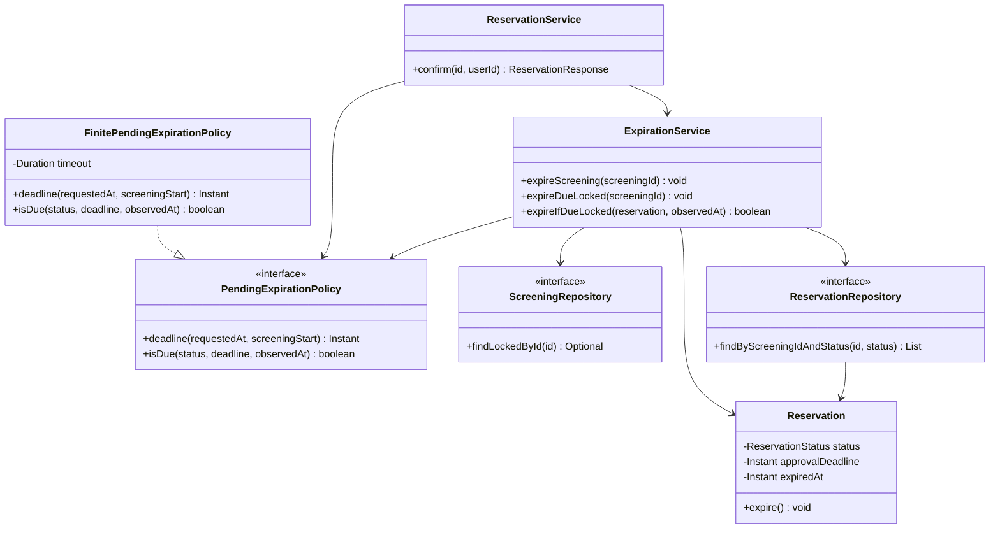
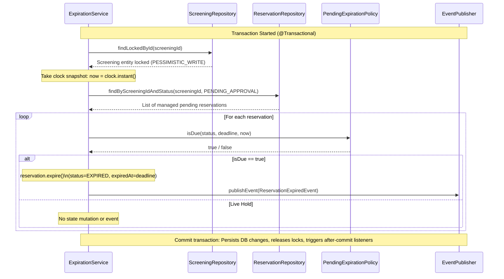

# C05 Detailed Design — Manage Pending Expiration

**Team:** Deadlock

**Domain:** Cinema Seat Reservation System

**Selected Architecture Unit:** Manage Pending Expiration (`Reservation Management`, C03 C2/G2)

**Baseline Alignment:** Baseline v0.2 / C03 Architecture

---

## 1. Context, Traces & Scope

### Scope & Invariants

* **Selected Unit:** Expiration policy computation, time guard enforcement, and authoritative transition to `EXPIRED` within the `Reservation Management` component.
* **Requirements & Rules:** REQ-11 (Automatic Expiration), REQ-02 (Coherent Availability Observation), OP-03/OP-05 lifecycle operations; BR-06 (Expiration Release), BR-08 (Finite Hold & Deadline Cap), BR-09 (Lifecycle Notifications).
* **Verification Scenarios:** V-07 (Deadline Boundary), V-13 (Late Approval Rejection), V-14 (Stale Decision & Clean Allocation Release).

### Architectural Boundary

* **Included:** Deadline computation during `Confirm` (OP-03), scheduled expiration sweeps via `ExpirationService`, inline due reconciliation prior to state mutations and availability queries, and post-commit notification event triggers.
* **Excluded:** Global active-allocation DB migration (C03 J-01–J-04), third-party notification transport providers, and public HTTP expiration endpoints (expiration is purely system-driven).

---

## 2. Detailed Responsibilities & Ownership Matrix

| ID | Detailed Responsibility | Architectural Justification | Design Owner |
| --- | --- | --- | --- |
| **D1** | **Validate Policy Configuration** | Enforces positive, non-null expiration timeout durations during policy instantiation to prevent zero-duration or invalid hold creation. | `FinitePendingExpirationPolicy` |
| **D2** | **Compute Finite Capped Deadline** | Calculates $t_{\text{deadline}} = \min(t_{\text{requested}} + \text{timeout}, t_{\text{screening\_start}})$, preventing Instant integer overflow on large durations. | `FinitePendingExpirationPolicy` |
| **D3** | **Evaluate Due Expiration Guard** | Evaluates whether a reservation is due for expiration ($t_{\text{observed}} \ge t_{\text{deadline}}$) using an inclusive boundary. | `FinitePendingExpirationPolicy` |
| **D4** | **Enforce Strict Lock Ordering** | Obtains `PESSIMISTIC_WRITE` on `Screening` before fetching pending holds to prevent race conditions with concurrent client actions. | `ExpirationService` |
| **D5** | **Execute Expiration Transition** | Mutates status to `EXPIRED`, sets `expiredAt = approvalDeadline` (preserving domain effective time), and releases seat holds. | `Reservation` (Domain Entity) |
| **D6** | **Dispatch Idempotent Notification** | Emits exactly one `ReservationExpiredEvent` per valid transition, processed after transaction commit. | `ExpirationService` & `EventPublisher` |

---

## 3. Key Interfaces & Contracts

### Interface Definition: `PendingExpirationPolicy`

```java
package com.reservedbytes.cinema_reservation.service;

import com.reservedbytes.cinema_reservation.model.ReservationStatus;
import java.time.Instant;

public interface PendingExpirationPolicy {
    Instant deadline(Instant requestedAt, Instant screeningStart);
    boolean isDue(ReservationStatus status, Instant deadline, Instant observedAt);
}

```

### Preconditions, Postconditions & Failure Contracts

* **`deadline(requestedAt, screeningStart)`**
* **Preconditions:** `requestedAt != null`, `screeningStart != null`, `requestedAt < screeningStart`, `timeout > 0`.
* **Postconditions:** `requestedAt < result <= screeningStart`, `result == min(requestedAt + timeout, screeningStart)`. Inputs remain unmutated.
* **Failure Modes:** Throws `IllegalArgumentException` if `requestedAt >= screeningStart` or configuration is non-positive. Throws `NullPointerException` if any parameter is `null`.


* **`isDue(status, deadline, observedAt)`**
* **Preconditions:** `status != null`, `observedAt != null`. `deadline` required if `status == PENDING_APPROVAL`.
* **Postconditions:** Returns `true` if and only if `status == PENDING_APPROVAL` and `observedAt >= deadline`. Returns `false` for non-pending states.
* **Failure Modes:** Throws `NullPointerException` on missing mandatory arguments.


* **`expireIfDueLocked(reservation, observedAt)`**
* **Preconditions:** Caller holds `PESSIMISTIC_WRITE` lock on the screening within an active transaction. `reservation` is a managed JPA entity.
* **Postconditions:** Returns `true` if transition occurred (`EXPIRED`, `expiredAt = approvalDeadline`, single event published). Returns `false` if hold remains live or state is non-pending.


---

## 4. Focused Structural Class View



---

## 5. Decision Logic & Detailed Sequence

### Decision Matrix

| Reservation State | Observed Time ($t_{\text{observed}}$) | Decision Outcome | State Side Effect | Event Published |
| --- | --- | --- | --- | --- |
| `PENDING_APPROVAL` | $t_{\text{observed}} < t_{\text{deadline}}$ | Hold Active | None | None |
| `PENDING_APPROVAL` | $t_{\text{observed}} == t_{\text{deadline}}$ | **EXPIRED** | `status=EXPIRED`, `expiredAt=deadline`, holds released | `ReservationExpiredEvent` |
| `PENDING_APPROVAL` | $t_{\text{observed}} > t_{\text{deadline}}$ | **EXPIRED** | `status=EXPIRED`, `expiredAt=deadline`, holds released | `ReservationExpiredEvent` |
| `CONFIRMED` / `CANCELLED` / `REJECTED` | Any | Ignored | None | None |

### Detailed Sequence Diagram (Scheduled Background Worker)



---

## 6. Verification Suite & Test Traceability

### DD-Derived Test Inventory (14 New Tests + Regression Suite)

| Test Level | Test Method Name | Validated DD Decision / Invariant | Outcome / Verification Criterion |
| --- | --- | --- | --- |
| **Unit** | `PendingExpirationPolicyTests.usesTimeoutWhenScreeningIsLater` | **D2:** Timeout projection when screening is far in future. | `deadline == requestedAt + timeout` |
| **Unit** | `PendingExpirationPolicyTests.capsDeadlineAtScreeningIncludingEquality` | **D2:** Capped deadline at screening start time. | `deadline == screeningStart` |
| **Unit** | `PendingExpirationPolicyTests.handlesHugeTimeoutWithoutInstantOverflow` | **D2:** Large duration safety check. | No `ArithmeticException` overflow. |
| **Unit** | `PendingExpirationPolicyTests.rejectsNonPositiveOrMissingConfiguration` | **D1:** Policy construction validation. | Throws `IllegalArgumentException`. |
| **Unit** | `PendingExpirationPolicyTests.rejectsRequestAtOrAfterStart` | **D2:** Request timestamp precondition guard. | Throws `IllegalArgumentException`. |
| **Unit** | `PendingExpirationPolicyTests.expiresExactlyAtDeadlineWithNanosecondPrecision` | **D3:** Inclusive boundary ($t == t_{\text{deadline}}$). | `isDue == true` exactly at boundary. |
| **Unit** | `PendingExpirationPolicyTests.neverExpiresNonPendingStates` | **D3:** Terminal/confirmed state immunity. | `isDue == false` for non-pending states. |
| **Unit** | `PendingExpirationPolicyTests.failsFastOnMissingRequiredInputs` | Contract Fast-Fail. | Throws `NullPointerException`. |
| **Unit** | `ExpirationServiceTests.dueTransitionKeepsEffectiveDeadlineAndPublishesOnce` | **D5, D6:** Effective deadline assignment & single event. | `expiredAt == deadline`, 1 event emitted. |
| **Unit** | `ExpirationServiceTests.livePendingDoesNotMutateOrNotify` | **D3:** Live hold non-mutation. | `status == PENDING_APPROVAL`, 0 events. |
| **Unit** | `ExpirationServiceTests.batchObtainsLockBeforeLoadingPendingAndUsesClock` | **D4:** Lock-before-load ordering. | Verification of repository execution order. |
| **Unit** | `ExpirationServiceTests.missingScreeningIsNoOp` | **D4:** Missing screening handling. | Early exit, no DB queries/events. |
| **Component** | `ReservationIntegrationTests.c05RepeatedWorkerCommitsOneExpirationAndReleasesWholeHold` | **D4–D6:** Multi-seat hold release & worker idempotency under Spring context. | Hold released, 1 notification logged after repeat sweep. |
| **Component** | `ReservationIntegrationTests.c05RollbackRestoresPendingAndSuppressesExpirationNotification` | **D5, D6:** Transactional rollback and notification suppression. | Rollback restores `PENDING_APPROVAL`, notification suppressed. |

### Level 1 & Level 2 Test Explanations

1. **Level 1 (Unit Test Explanation — `expiresExactlyAtDeadlineWithNanosecondPrecision`):**
Evaluates pure decision logic ($D3$) in memory without Spring context, database connections, or real-time waiting. By passing explicit `Instant` values down to nanosecond precision, it proves that $t_{\text{observed}} == t_{\text{deadline}}$ returns `true` while $t_{\text{deadline}} - 1\text{ns}$ returns `false`.
2. **Level 2 (Component/Integration Test Explanation — `c05RollbackRestoresPendingAndSuppressesExpirationNotification`):**
Evaluates transactional boundary integration ($D5–D6$) using Spring Boot and H2. Mocking cannot verify Spring's `@TransactionalEventListener(phase = AFTER_COMMIT)`. This test forces an unhandled exception during the transaction to confirm that `status` reverts to `PENDING_APPROVAL` in the database and the notification listener is suppressed.

---

## 7. Implementation Delta & Design Risk Analysis

### DD ↔ Code Comparison Matrix

| Design Decision | Implementation Status | Evidence / Location | Action Taken |
| --- | --- | --- | --- |
| **Policy Strategy Pattern** | **YES** | `service/PendingExpirationPolicy.java`, `FinitePendingExpirationPolicy.java` | Refactored timeout calculations into clean strategy class. |
| **Overflow-Safe Deadline** | **YES** | `FinitePendingExpirationPolicy.deadline()` | Replaced `plus()` with `Duration.between()` comparison. |
| **Single Expiration Point** | **YES** | `ExpirationService.expireIfDueLocked()` | Eliminated duplicate expiration logic in `ReservationService`. |
| **Lock-Before-Load** | **YES** | `ExpirationService.expireScreening()` | Enforced screening lock retrieval prior to loading pending entity lists. |
| **Effective Deadline History** | **YES** | `Reservation.expire()` | Assigned `expiredAt = approvalDeadline` instead of system wall-clock. |
| **After-Commit Notifications** | **YES** | `NotificationService` + Spring Event Publisher | Retained transactional listener phase. |

### Remaining Design Risks & Mitigations

* **Lock Contention:** Coarse `PESSIMISTIC_WRITE` locks on `Screening` serialize all reservations for a given screening. *Mitigation:* Kept transactions brief; targeted for fine-grained allocation locks in full C03 refactoring.
* **In-Memory Notification Loss:** The transactional event listener logs notifications post-commit but lacks persistent retry if the process terminates immediately after commit. *Mitigation:* Documented as a known C02/C05 limitation to be addressed by the C03 Transactional Outbox pattern (ADR-02).
* **Clock Drift in Distributed Environments:** Multi-instance deployments could experience clock skew during deadline evaluation. *Mitigation:* Database and backend nodes must utilize NTP synchronization; clock injection enables deterministic testing.

---

## 8. Verification Results & Definition of Done

### Automated Execution Results (Date: 2026-10-19)

* **Environment:** JDK Temurin 21.0.12.1, Maven 3.9.16, H2 Embedded.
* **Execution Command:** `./mvnw clean test`
* **Test Results:** **BUILD SUCCESS** (74 total tests executed, 0 failures, 0 errors, 0 skipped).
* `ReservationIntegrationTests`: 61 tests passed.
* `PendingExpirationPolicyTests`: 8 tests passed.
* `ExpirationServiceTests`: 4 tests passed.
* `CinemaReservationApplicationTests`: 1 test passed.


* **Architecture Conformance Check (`check_architecture.py`):** **PASS** (2 controllers verified, 0 direct persistence imports).
* **Git Tag Reference:** `c05-detailed-design-v1`