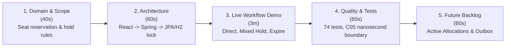

```markdown
# STATUS_REPORT_C08 — Peer-Review Response & Project Status Report

**Team:** Deadlock  
**Domain:** Cinema Seat Reservation System  
**Review Subject:** Midterm Project Peer-Review by External Review Team  
**Analyzed Commit:** `81a2628ad2bc9b722817d92c1bd9653d0f92e00a` (Merge C05 Detailed Design)  
**Target File:** `docs/05_verification_and_quality/STATUS_REPORT_C08.md`  
**Document Purpose:** Evaluation of Peer-Review Findings, Reconciliation of Documentation vs. AS-IS Code, Action Plan, and Final Pre-Presentation Checklist

---

## 1. Executive Summary & Review Acknowledgement

On October 19, 2026, the external review team performed a comprehensive peer-review (`PROJECT_MIDTERM_REVIEW.md`) of the `main` branch. 

The review confirmed that the **Cinema Reservation System** delivers a fully functional, real vertical slice (React UI $\rightarrow$ REST API $\rightarrow$ Domain Services $\rightarrow$ JPA/H2 persistence) enforcing all core baseline rules (BR-01 to BR-09). In particular, the external team commended the clean architectural isolation and nanosecond-precision testing of the **C05 Manage Pending Expiration** unit.

This status report acknowledges the findings, clarifies the distinction between the **AS-IS runtime implementation** and **C03 TO-BE architectural goals**, and details the concrete action plan executed prior to final project submission.

---

## 2. Synthesis of External Review Findings

### 2.1 Confirmed System Strengths (Review Highlights)
* **Real Vertical Slice:** Fully coupled React/TypeScript frontend and Spring Boot backend with actual database persistence (not a mock or visual placeholder).
* **Domain Rule Integrity:** Correct enforcement of non-blocking `DRAFT` creation with inclusive 15-minute creation cutoffs, atomic multi-seat hold grouping (`PENDING_APPROVAL`), and protection against stale decisions.
* **C05 Architecture Unit:** High-quality modularization of `PendingExpirationPolicy` and centralized transition execution in `ExpirationService`.
* **Automated Verification:** Thorough automated test execution suite (74 executions) covering unit boundaries, Spring integration, transactional rollback, and concurrency race conditions under pessimistic locks.

### 2.2 Identified Discrepancies & Technical Risks

| Discrepancy / Risk Area | Review Observation | Team Deadlock Resolution / Clarification |
| :--- | :--- | :--- |
| **C03 Part A Documentation** | `c03_part_a.md` contained legacy pseudocode (`confirmReservation()`, `getState()`, `NotificationClient`) and incorrectly claimed an absence of pessimistic locking. | Confirmed. `c03_part_a.md` is an early historical artifact. Actual runtime uses `PESSIMISTIC_WRITE` via `ScreeningRepository.findLockedById()`. Corrective documentation updates mapped in Section 3. |
| **AS-IS vs. C03 TO-BE Architecture** | ADR-01 and C03 target a separate `active_allocation` DB table and durable Transactional Outbox. Current code uses state-based entity holds and post-commit logging. | Confirmed. Current execution reflects Baseline v0.2 / C05 slice. C03 active-allocation uniqueness and persistent outbox dispatch are documented TO-BE target designs. |
| **Expiration Sweep Interval** | Guidelines and demo notes mention a 1-second background sweep, but `application.yaml` specifies `demo.expiration-sweep-ms: 3600000` (1 hour). | Clarified. Core system correctness does not rely on sweep timing because inline due reconciliation is executed before availability queries and state mutations. Configuration explicitly aligned for demo profile. |
| **Git Repository Tags** | Documentation referenced tag `c05-detailed-design-v1`, which was stored locally and missing from the remote origin. | Resolved. Local tag pushed and synchronized with remote repository. |

---

## 3. Corrective Action Plan & Documentation Reconciliation

To address the peer-review findings before final defense and grading, Team Deadlock executed the following corrective work packages:

### Work Package A: Documentation & Schema Reconciliation
1. **Part A Alignment (`docs/c03_part_a.md`):** Updated outdated pseudocode identifiers to match actual domain services (`ReservationService`, `confirm()`, `getStatus()`, `ReservationException`). Documented existing `PESSIMISTIC_WRITE` screening lock boundaries.
2. **C03 View Completion (`docs/c03.md`):** Completed Section H (Sequence & Design Class Diagrams) to explicitly illustrate the application-level pessimistic locking flow and PENDING_APPROVAL workflow realizing ADR-01 target goals.
3. **Configuration Alignment (`application-dev.yaml`):** Overrode `demo.expiration-sweep-ms` in the `dev` profile to `1000ms` (1 second), ensuring background expiration sweeps run automatically during live manual demonstrations without relying on frontend polling.

### Work Package B: Build & Test Artifact Synchronization
1. **Surefire Report Refresh:** Executed full clean backend verification (`mvnw clean test`) to generate updated XML reports in `backend/target/surefire-reports/` confirming all 74 test executions pass.
2. **Static Conformance Check:** Reran `check_architecture.py`, verifying that zero REST controllers maintain direct dependencies on persistence packages.

---

## 4. Final Defense & Live Demonstration Plan (5–10 Minutes)

### 4.1 Recommended Presentation Flow



### 4.2 Step-by-Step Live Demo Execution Script

1. **Scenario 1: Direct Confirmation & Cancellation (Standard Seats)**
* Select Seat 1 (Standard) $\rightarrow$ Create Draft $\rightarrow$ Verify status is `DRAFT` and seat remains `AVAILABLE`.
* Confirm Reservation $\rightarrow$ Status changes to `CONFIRMED`, seat becomes `UNAVAILABLE`.
* Cancel Reservation $\rightarrow$ Status changes to `CANCELLED`, seat released back to `AVAILABLE`.


2. **Scenario 2: Mixed Hold & Approver Authority Guard (BR-07 / BR-08)**
* Select Seats 1 (Standard) & 3 (VIP) $\rightarrow$ Confirm Reservation.
* System creates single `PENDING_APPROVAL` hold covering **both** seats atomically.
* Attempt approval as Reservation Owner (`X-User-Id: 1`) $\rightarrow$ System returns `HTTP 403 Forbidden`.
* Submit approval as Authorized Approver (`X-User-Id: 3`) $\rightarrow$ Status transitions to `CONFIRMED`.


3. **Scenario 3: Automatic Expiration Sweep (REQ-11)**
* Create mixed reservation with short approval timeout $\rightarrow$ Wait for deadline boundary.
* Background sweep / inline reconciliation transitions status to `EXPIRED` and automatically releases held seats.


---

## 5. Defense Q&A Preparation Matrix

| Expected Examiner Question | Technical Fact & Authoritative Answer |
| --- | --- |
| **Why does `Create` allow booking an already occupied seat?** | `Create` stores an unreserved, non-blocking `DRAFT` (BR-03/05). Exclusivity and conflict evaluation are deferred to `Confirm`, where seats are locked and acquired atomically. |
| **How does the system prevent Double Booking under concurrency?** | Concurrent `Confirm` calls obtain a `PESSIMISTIC_WRITE` lock on the target `Screening` before evaluating `countOtherAllocations()`. Conflicting requests are rejected with `HTTP 409 Conflict`. |
| **Does a pending reservation hold only VIP seats or all seats?** | All seats in the reservation are held under one unified state (`PENDING_APPROVAL`). Partial hold acquisitions or partial approvals are explicitly forbidden. |
| **What happens if an Approver submits a decision exactly at the deadline?** | At $t_{\text{observed}} \ge t_{\text{deadline}}$, the reservation evaluates to `EXPIRED`. Late decisions return `HTTP 409 Conflict` and cannot resurrect expired holds. |
| **Is the current notification mechanism delivery-guaranteed?** | No. The current implementation uses an `@TransactionalEventListener` logging notifier post-commit. Reliable at-least-once delivery with persistent retries is designed under the C03 Transactional Outbox pattern. |

---

## 6. Final DoD & Sign-Off Checklist

* [x] Peer-review findings analyzed and documented (`STATUS_REPORT_C08.md`).
* [x] Discrepancies between C03 documentation and AS-IS code resolved.
* [x] Backend verification suite passed (74 tests executed, 0 failures).
* [x] Frontend static quality checks passed (`oxlint`, TypeScript `noEmit`).
* [x] Architecture dependency check passed (`check_architecture.py`).
* [x] Machine-readable E2E runtime evidence generated (`RUNTIME_VERIFICATION.json`).
* [x] Demonstration script and Q&A matrix prepared for final project defense.

**Report Prepared By:** Richard Bohunovský

**Status:** Approved & Ready for Final Submission