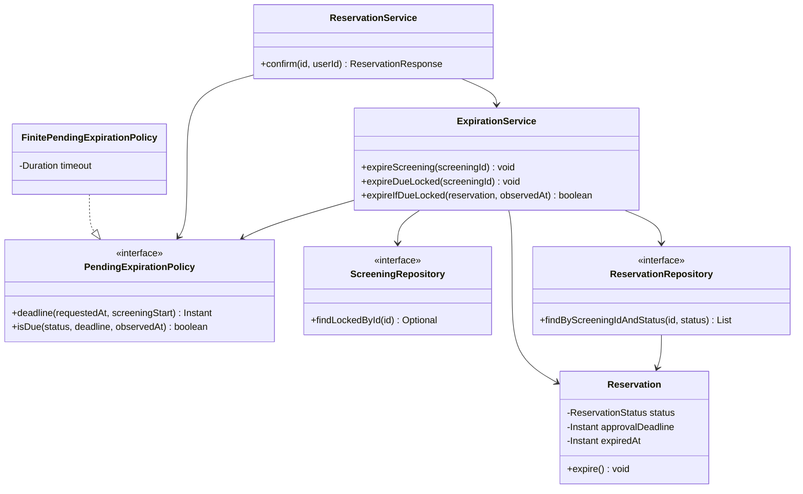

# Architecture and Decisions

## Runnable C02 v0.2

Retain Spring Boot, JPA, injected UTC Clock, H2 profiles, the React/Vite frontend
and the lightweight after-commit Notification Service. No C03 redesign.

Create still persists non-blocking DRAFT with the inclusive 15-minute boundary.
Confirm acquires all seats as either CONFIRMED or PENDING_APPROVAL. One persisted
reservation status determines the allocation of every associated seat; there is
no separate per-seat lifecycle. Approve converts the existing hold in place.

The existing pessimistic screening lock now protects Confirm, Cancel, Approve,
Reject and expiration. A scalar screening lookup occurs before loading the
reservation, avoiding stale state while waiting. Locks are held through commit;
all transitions within one screening serialize, including disjoint seats.
Availability/status also take that lock for a coherent observation. This is
intentionally simple and coarse for C02, not a scalability solution.

The demo policy selects seat numbers 3 and 4; others confirm directly. Confirm
retains required seat IDs, policy label and authorized Approver 3. Owner and
Approver checks remain separate. X-User-Id is a demo caller convention, not
trusted authentication. GET /reservations/{id} is an owner read surface; approval
uses the minimal body {decision: APPROVE|REJECT}. Both schemas are implementation
choices pending C03 API design.

A configurable 60-second demo duration yields min(request+duration, screening
start). A one-second in-process sweep and pre-read system transaction resolve
expiration. OP-02's query stays read-only and filters already-due pending holds.
Mutations re-evaluate deadline/state while holding the same lock. Domain error
responses commit any independent system expiration; no requested invalid
transition is performed. Unauthorized decisions check authority first. expiredAt
is the effective deadline. Terminal records and decision/cancellation metadata
remain observable; drafts have no TTL.

Final confirmation, cancellation, rejection and expiration publish immutable
response events; the unchanged Notification Service logs them only after commit.
Pending submission and rejected operations do not publish final confirmation.
There is no queue, external messaging provider or delivery guarantee.

## Drivers exposed for C03 (not solved here)

| Driver | Evidence / remaining design pressure |
|---|---|
| Persistent delayed approval | Requests span multiple HTTP calls; snapshot and deadline must survive deployment/restart in the eventual production store |
| Authority separate from ownership | Owner decisions fail 403; production identity trust and Resource-scoped grants need design |
| Time and expiration | UTC Clock tests equality; effective deadline and processing time differ; reliable processing and coordination across instances need design |
| Lifecycle concurrency | Confirm/Cancel/decision/expiration must share valid sequential ordering; coarse screening lock limits throughput |
| Atomic multi-seat allocation | Mixed reservation is one hold; conflict cannot acquire a free subset; durable enforcement/recovery need design |
| Stale-decision protection | Terminal old request cannot affect seats acquired by a new request; retried/duplicated commands need deliberate API semantics |
| Observable status/history | Pending progress, authority and outcome metadata are retained; production read contract/audit design remains open |
| Notifications | Only committed final transitions notify; durable delivery, retry and idempotency remain C03 responsibilities |

Production approval criteria and authority assignment, exact finite timeout,
status/decision representation and future abandoned-draft TTL remain genuine
policy/API TBDs. Reliable scheduling, persistence strategy, transaction technique,
invariant recovery and notification delivery are C03 design decisions. None
permit weakening v0.2's resolved states, authority, deadline or exclusion rules.

## C05 Detailed Design

### Selected architecture unit

**Jednotka:** správa expirace čekající rezervace (`Manage pending expiration`, C03 C2/G2, uvnitř Reservation Management). Slice zahrnuje stanovení deadline při Confirm a autoritativní vyhodnocení expirace při sweepu i při commandu. Nemění alokační architekturu celého systému.

**Zdroje:** [C03 C2, G2, G3 a J-07](c03.md), [baseline v0.2](c02_baseline_specification_v0.2.md): REQ-11, návazně REQ-02 a OP-03/OP-05; BR-06, BR-08, BR-09; scénáře V-07, V-13 a uvolnění/stale decision V-14. Deadline je konečný, nejpozději v začátku projekce. Schválení je možné výhradně před deadline. Zpožděný worker nesmí obnovit prošlý hold. `expiredAt` znamená efektivní deadline, nikoli čas zpracování.

**Hranice:** scheduler pouze spouští zpracování; policy pouze rozhoduje o čase; ExpirationService provádí přechod a publikuje událost v transakci. Oprávnění, potvrzení, storno a rozhodnutí Approvera nadále vlastní ReservationService. Dostupnost používá existující due-aware databázový dotaz. C05 nepovažuje dosud nerealizované C03 active-allocation/outbox změny za hotové. Lokální timeout PT60S je konfigurace demo varianty, nikoli nové produkční business pravidlo.

### Detailed responsibilities

| ID | Detailed responsibility | Why is it needed? |
|---|---|---|
| D1 | Validovat kladný timeout při vytvoření policy | Nulový/záporný timeout nesmí vytvořit neplatný pending hold. |
| D2 | Stanovit konečný deadline omezený začátkem projekce | BR-08 zakazuje hold za začátkem; výpočet nesmí přetéct ani s velkým timeoutem. |
| D3 | Rozhodnout, zda konkrétní stav v daném okamžiku expiruje | Jediná definice inkluzivní hranice; terminální stavy se nemění. |
| D4 | Načíst pending rezervace až pod screening zámkem | Konkurenční approval/cancel/expire musí mít platné sekvenční pořadí. |
| D5 | Provést EXPIRED a uchovat efektivní deadline | Historie musí odpovídat business okamžiku i při opožděném zpracování. |
| D6 | Publikovat právě jednu událost za skutečný přechod | Opakované zpracování nesmí generovat další expirační událost. |

### Design elements and ownership

Cesty v této sekci jsou relativní k `backend/src/main/java/com/reservedbytes/cinema_reservation/`.

| Responsibility | Owner | State/data | Why here? |
|---|---|---|---|
| D1, D2, D3 | `service/FinitePendingExpirationPolicy`, implementace `PendingExpirationPolicy` | Neměnný Duration timeout; Instant vstupy, žádné entity/repository ani Clock | Čistá rozhodnutí izolovaná od infrastruktury; explicitní variation point. |
| D4 | `service/ExpirationService.expireScreening` | Screening ID, injected Clock; repository závislosti | Spring transakční hranice a jednotné pořadí lock → load. |
| D5 | `ExpirationService.expireIfDueLocked` + `model/Reservation.expire` | Reservation vlastní status, approvalDeadline, expiredAt a množinu všech sedadel | Service střeží guard, entita ukládá stav a historii. |
| D6 | ExpirationService + ApplicationEventPublisher | Neměnný snapshot ReservationResponse po změně | Publikace patří k přechodu; NotificationService zpracuje až po commitu. |
| Použití D2 při Confirm | `service/ReservationService` | approvalRequestedAt a vypočtený deadline persistovaný s pending | Časová policy není znovu implementována v commandu. |

`PendingExpirationPolicy` nevlastní proměnlivý doménový stav. Reservation vlastní deadline snapshot; pozdější změna konfigurace existující deadline nepřepočítá. Jeden status rezervace určuje blokování všech sedadel: EXPIRED uvolní celý hold. Bez další cache nebo nového per-seat lifecycle.

### Key interfaces / contracts

```java
interface PendingExpirationPolicy {
    Instant deadline(Instant requestedAt, Instant screeningStart);
    boolean isDue(ReservationStatus status, Instant deadline, Instant observedAt);
}
```

**`deadline`:** preconditions: neprázdné Instant vstupy, requestedAt < screeningStart a při konstrukci policy timeout > 0. Postcondition: requestedAt < result <= screeningStart, result = min(requestedAt + timeout, screeningStart), vstupy nezměněny. Porovnání Duration před sčítáním předchází overflow. Failures: `IllegalArgumentException` při nekladném/null timeoutu nebo požadavku v/po začátku; `NullPointerException` při null Instant. Jde o interní kontrakt; veřejné HTTP guardy nadále vracejí existující 409 před voláním této operace.

**`isDue`:** status a observedAt nejsou null; deadline je povinný pouze pro PENDING_APPROVAL. Result = pending AND observedAt >= deadline. Pro ostatní stavy false i s null deadline. Žádné side effects; null povinného vstupu → NullPointerException (chyba konfigurace/dat/volajícího, ne běžný konflikt). Nepřijímá implicitní systémový čas.

**`expireIfDueLocked(reservation, observedAt) : boolean`:** volající drží screening PESSIMISTIC_WRITE zámek v aktivní transakci, entita je aktuální managed instance. Při true je EXPIRED, expiredAt = approvalDeadline a byla publikována jedna expirační response událost. Při false žádná změna ani událost. Publikace proběhne uvnitř transakce, listener až po úspěšném commitu. Interní/runtime chyba propaguje a transakce se vrací zpět; metoda sama transakci neotevírá. Lock precondition není dynamicky vynucována touto metodou.

### Focused structural view

Sedm významných UML prvků; externí Clock a publisher jsou constructor dependencies uvedené v ownership tabulce. Stereotyp interface vyznačuje kontrakt; šipka realizace vede od implementace k rozhraní.



### Important methods / operations

| Operation | Responsibility | Input / Output | Preconditions | Postconditions | Side effects | Failure behavior |
|---|---|---|---|---|---|---|
| `FinitePendingExpirationPolicy(Duration)` | D1 | timeout / policy | Žádné | Platná neměnná policy | Žádné | Invalid timeout → IllegalArgumentException, startup selže. |
| `deadline` | D2 | request, start / Instant | Viz kontrakt | Konečný capped deadline | Žádné | Viz kontrakt, bez zápisu. |
| `isDue` | D3 | status, deadline, now / boolean | Viz kontrakt | Přesný inkluzivní guard | Žádné | Chybějící povinná data → NPE. |
| `expireScreening` | D4 | screeningId / void | Volání přes Spring proxy | V okamžiku pozorování jsou due pending v projekci zpracované | Zámek, DB transakce, navazující změny | Chybějící screening → no-op; persistence chyba propaguje/rollback. |
| `expireDueLocked` | D3–D6 | screeningId / void | Aktivní transakce, screening lock | Zpracuje pending načtené pod zámkem proti jednomu Clock snapshotu | Mutace managed entit, události | Chyba propaguje; transakční chování určuje veřejný vstup. |
| `expireIfDueLocked` | D5, D6 | Reservation, observedAt / boolean | Viz kontrakt | True pouze při skutečném přechodu | EXPIRED, expiredAt, event | Opakování false; runtime chyba propaguje. |

### Algorithm / decision logic

```text
construct(timeout): reject null or timeout <= 0

deadline(requestedAt, start):
    reject missing inputs or requestedAt >= start
    remaining = Duration.between(requestedAt, start)
    if timeout >= remaining: return start
    return requestedAt + timeout

expireScreening(screeningId):              // Spring transaction
    if screening lock lookup is absent: return
    now = injectedClock.instant()          // one snapshot after acquiring lock
    pending = repository.loadPending(screeningId)
    for each reservation in pending:
        expireIfDueLocked(reservation, now)
    commit                                 // listeners after commit

expireIfDueLocked(reservation, now):
    if status != PENDING_APPROVAL: return false
    require persisted deadline
    if now < deadline: return false
    reservation.expire()                   // expiredAt = deadline
    publish immutable response snapshot
    return true
```

| Stav / čas | Výsledek | Event |
|---|---|---|
| PENDING_APPROVAL, now < deadline | Beze změny | Žádný |
| PENDING_APPROVAL, now = deadline | EXPIRED | Jeden |
| PENDING_APPROVAL, now > deadline | EXPIRED, expiredAt = deadline | Jeden |
| DRAFT/CONFIRMED/CANCELLED/REJECTED/EXPIRED | Beze změny | Žádný |

### Detailed sequence

Konkrétní průchod workeru, nikoli obecný architektonický API → DB diagram. Pět účastníků; transakce začíná Spring proxy před vstupem do služby, zámek trvá do commitu. Scheduler pouze zavolá službu pro nalezenou projekci.

```mermaid
sequenceDiagram
    participant E as ExpirationService
    participant S as ScreeningRepository
    participant R as ReservationRepository
    participant P as PendingExpirationPolicy
    participant N as EventPublisher
    Note over E,N: Aktivní transakce
    E->>S: findLockedById(screeningId)
    S-->>E: screening s PESSIMISTIC_WRITE zámkem
    Note over E: now = clock.instant()
    E->>R: findByScreeningIdAndStatus(id, PENDING_APPROVAL)
    R-->>E: managed pending rezervace
    loop Každá pending rezervace
        E->>P: isDue(status, deadline, now)
        P-->>E: due
        alt due
            Note over E: reservation.expire(), expiredAt = deadline
            E->>N: publishEvent(response snapshot)
        else ještě živá
            Note over E: Žádná mutace ani událost
        end
    end
    Note over E,N: Commit uloží entity a uvolní zámek; listener běží po commitu
```

**Souběh a persistence:** zachován stávající coarse screening lock, scalar lookup před načtením rezervace a transakční dirty checking. Confirm/Cancel/Approve používají tentýž lock a čerstvý časový recheck. Duplicitní worker po získání zámku uvidí terminální stav a nic nepublikuje. Recheck v commandu zachytí i deadline dosažený během jeho zpracování. Neautorizovaný approval nadále kontroluje autoritu před mutací. Due-aware read query zůstává read-only. Přesné porovnání v SQL musí zachovat stejnou hranici jako policy; existující integrační test ji ověřuje. Zvolený snapshot je okamžik rozhodnutí; commit může následovat později.

**Vztah k C03:** tento slice realizuje detail uvnitř Reservation Management a zachovává současnou C02 persistence strategii. Neřeší J-01–05 (unikátní aktivní alokace, outbox/migrace) ani J-07 v budoucí variantě s rollbackem DB acquisition konfliktu. Při zavedení těchto změn musí nezávislé expiration reconciliation zůstat platné. Aktuální kód používá `noRollbackFor=ReservationException` na commandech a samostatnou pre-read system transakci; tyto hranice se zde nemění. Požadavek C05 je jedna jednotka, nikoli dokončení celého C03 backlogu.

### DD decisions intentionally left to code

Lokální názvy proměnných, imports, getter boilerplate, konkrétní syntaxe iterace a konstrukce DTO. Časové hranice, timeout, lock ordering, transakční hranice, ownership a event chování nejsou ponechány implicitně. Změna timeoutu patří do konfigurace, změna časové politiky do nové implementace rozhraní; trvalý deadline existujících holdů se nemění.

### Maintainability / extension

Policy je bez Clock/repository a testuje se bez Springu. Přechod se publikuje na jednom místě místo dvou kopií ve službách. Nová timeout varianta implementuje stejné kontrakty; musí zachovat BR-08 a projít hraničními testy. Veřejné API, status model a UI se nemění.
